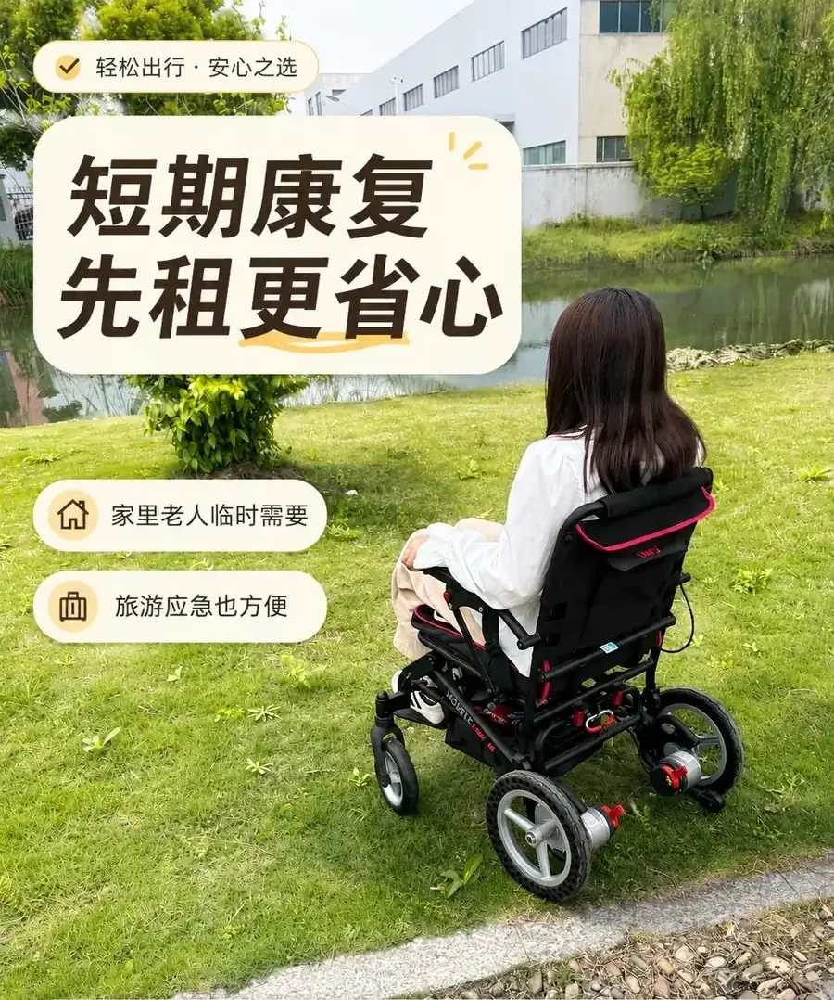
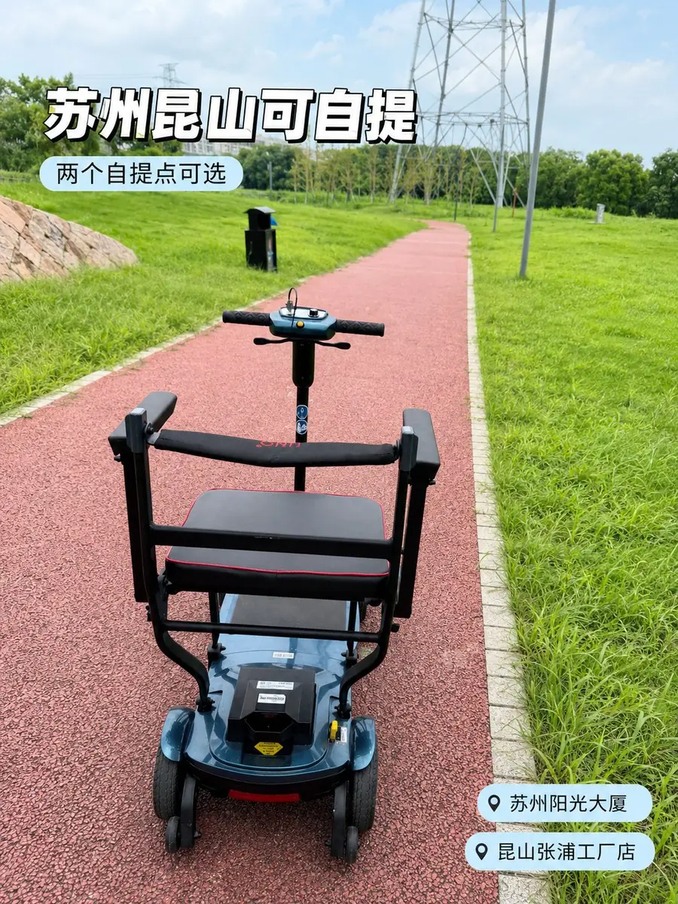
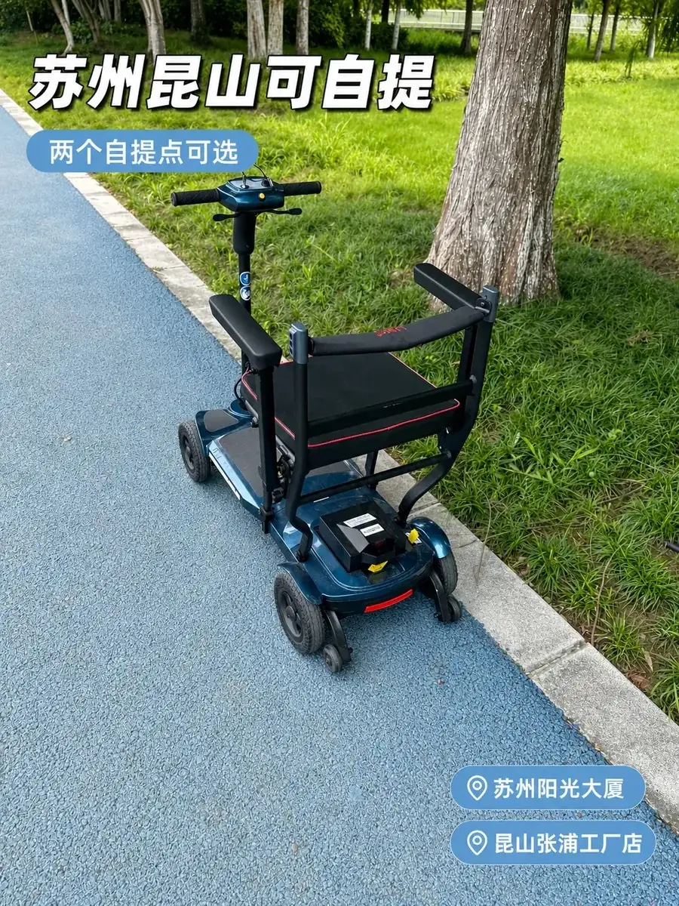

# 在昆山、苏州租轮椅：多少钱、哪些车能租、押金怎么退

老人膝盖疼，走两百米就要歇；刚做完手术，推着去拍片、换药；外地父母来昆山、苏州住一阵子，想出门转转。真到要用轮椅的时候，很多人的第一反应是“买一台吧”。

买回来才发现，可能只用半个月，家里多占一块地方，转卖还亏一截。

这篇把昆山、苏州能租到的轮椅讲清楚：什么价格、有哪些车、押金怎么退、去哪儿取怎么还。**里面的数字都来自公司的价格表、库存清单和租赁流程、协议**，你可以拿着这篇去门店对。

> 价格和押金摘自公司《轮椅租赁价格表》，车型、库存、电池配置摘自 2026 年 5 月 27 日更新的《佳康顺轮椅租赁库存清单》，按车型的日租和两档押金摘自《佳康顺轮椅租赁流程》，核对时点 2026-10-15。库存是动态的，去之前问一句最保险。

## 先定一件事：你要用几天

租还是买，其实只取决于“用多久”。

- **三五天**：出门旅游、陪老人办事、临时陪护。手动轮椅租 3 天 39 元，跟买一台不是一个量级的钱。
- **一到两周**：术后早期、短期康复。医院型 7 天 99 元，电动轻便型 7 天 308 元。
- **一个月以上**：长期坐卧、要自己出门代步。电动轻便型租满 30 天 750 元，折合 25 元/天，比按天零租划算。

用几天就付几天，用完就还，这是租最省的地方。

## 一天多少钱：四个档位，14 种租期

价格表把轮椅分成四档：手动三档（飞机轮椅、医院型、重型款），电动一档（轻便型）。车型配置可以在公司官网的[电动轮椅车型页](https://www.unqcare.com/product/1/)上对照。

租期从 1 天到 30 天一共 14 个价，下表单位为元，数值取自价格表原文：

| 租期 | 飞机轮椅（手动） | 医院型（手动） | 重型款（手动） | 轻便型（电动） |
|---|---|---|---|---|
| 1 天 | 15 | 20 | 40 | 50 |
| 2 天 | 28 | 38 | 78 | 98 |
| 3 天 | 39 | 54 | 114 | 144 |
| 4 天 | 48 | 68 | 148 | 188 |
| 5 天 | 55 | 80 | 180 | 230 |
| 6 天 | 60 | 90 | 210 | 270 |
| 7 天 | 64 | 99 | 238 | 308 |
| 8 天 | 68 | 107 | 264 | 344 |
| 9 天 | 72 | 114 | 288 | 378 |
| 10 天 | 75 | 120 | 310 | 410 |
| 15 天 | 102 | 150 | 405 | 525 |
| 20 天 | 132 | 180 | 470 | 610 |
| 25 天 | 165 | 210 | 520 | 682 |
| 30 天 | 198 | 240 | 580 | 750 |

四档在价格表里对应的车型是：

- **飞机轮椅**：轻量手推的手动轮椅，主打便携。
- **医院型**：以 865-20 为代表的常规手推轮椅。
- **重型款**：EY-05、EY500-16，以及移位机 HY201-01A、起身器 H010 四电机。
- **电动轮椅轻便型**：P20C、EY-18、EY-15、P15、P10 旅行、EY07、X3 全碳、P11 全碳。

这张表有个规律，看一眼就能记住：

- **前一周降得最快。** 飞机轮椅从 1 天的 15 元/天降到 7 天的 9.14 元/天；电动轻便型从 50 元/天降到 44 元/天。
- **一周之后越往后越平。** 从 15 天到 30 天，飞机轮椅只从 6.8 元/天走到 6.6 元/天，几乎不动；医院型从 10 元降到 8 元；重型款从 27 元降到 19.33 元；电动轻便型从 35 元降到 25 元，这一档降得最明显。
- **挑台阶看用量。** 临时几天就按 6 天以内的价算，一两周看 10 天或 15 天，超过三周直接按 30 天算。

### 为什么别人报的价比这张表低

公司内部的《佳康顺轮椅租赁流程》里，还有一套按车型的日租：

| 车型 | 日租（元/天） |
|---|---|
| 康贝星 | 18 |
| 希维尔 SYIV100 | 20 |
| EY500-16 | 30 |
| EY-19 | 35 |
| P16、EY-18 | 40 |
| 移位机 HY201-01A、起身器 H010 四电机 | 35 |

**短租的时候，这套确实更便宜。** 比如 EY500-16 一天 30 元，而上面表格里电动轻便型租 1 天是 50 元。

**但租久了会反过来。** 轻便型租满 15 天折合 35 元/天，已经跟这套报价的 35 元档打平；租到 25 天是 27.28 元/天，比上面任何一款电动都低。移位机、起身器的 35 元/天，也接近重型款租 6 到 7 天的日均。康贝星、希维尔 SYIV100 这两款手动轮椅，跟手动档位价接近或略高。

所以问价的时候，**一定要先说明租几天**，让门店按对应口径报，比自己猜省事。

另外提醒一句：线上推广文案写的是“手动轮椅 15 元/天起、电动轮椅 40 元/天起”，跟上面两套口径都不完全一致。以门店当天报价为准。

### 租金之外，还有三笔钱要算

- **押金**：价格表口径是手动轮椅 600 元、电动轮椅 2000 元。走闲鱼平台担保交易时更低：手动 300 元、电动 600 元。不走担保则按手动 600 元、电动 2000 元起收，EY-19、P16、EY-18 会到 3000 至 3500 元；移位机与起身器担保 600 元、不担保 2500 元。
- **配送**：价格表写的是“10 公里内送货上门 30 元”，但流程文件写的是“不主动推销、不上门送货，客户需到店自提”。两份文件口径不一致，需要送货就先问清楚这个网点送不送。
- **配件**：移位机吊带 250 元、起身器床垫 200 元，都是单独买的。

## 现在有哪些车能租

按 2026 年 5 月 27 日更新的库存清单，在租车型共 16 款：标注充足 5 款、紧张 3 款、缺货 1 款，另有高端款和旗舰款各 1 款，剩下 5 款没标库存状态。

| 型号 | 电池配置 | 库存 | 状态 |
|---|---|---|---|
| 865-20 | / | 40+ 台 | 充足 |
| P15 | 10 锂电 | 20+ 台 | 充足 |
| P20C | 10 锂电 | 20+ 台 | 充足 |
| P10 旅行 | 6 / 10 / 20 锂电 | 10+ 台 | 充足 |
| P16L | 10 锂电 | 20+ 台 | 充足 |
| X3 全碳 | 10 锂电 | 20+ 台 | 高端款 |
| P11 全碳 | 10 锂电 | 10+ 台 | 旗舰款 |
| EY-18 | 10 / 20 锂电 | 7 台 | / |
| EY-19 | 10 锂电 | 5 到 6 台 | / |
| EY-15 | 12 铅酸 / 10 锂电 / 20 锂电 | 4 台 | 紧张 |
| EY07 | 10 锂电 | 3 到 4 台 | 紧张（缺电池） |
| EY500-16 | 12 锂电 | 1 到 2 台 | 紧张 |
| P16 | 10 锂电 | / | / |
| 飞机轮椅（阳光） | / | / | / |
| 小飞机轮椅 | / | / | / |
| EY-05 | / | 没货 | 缺货 |

挑车的时候，盯住这三点就行：

- **电池决定重量。** 铅酸更重、更便宜，锂电更轻。EY-15 同时有 12 铅酸、10 锂电、20 锂电三个版本，同一台车选哪种电池，搬上搬下的难度差很多。价格表按档位定价，同一档位不区分电池版本；按车型的日租会不会随电池变，问门店。
- **标“紧张”和“缺货”的要提前问。** EY-15、EY07、EY500-16 库存偏紧，EY-05 已经没货。节假日或者集中用车之前，先确认有没有车。
- **同型号的不同电池版本算同一款车。** P10 旅行有 6、10、20 锂电三种配置，价格按档位走，具体配置要和门店确认。

> 清单里另有一列表头是“租赁价”，数值从 480 元到 12,800 元。它没写按什么口径计价，没法跟按天的档位价直接比，这篇只按原样引用，不当日租或售价使用。

## 手动还是电动，看三件事

**第一件：用几天。** 3 天以内（探亲、旅游应急、临时陪护），手动轮椅就够，优先飞机轮椅档位，3 天 39 元。1 到 2 周（术后早期、短期康复），看手动医院型或电动轻便型，医院型 7 天 99 元，电动轻便型 7 天 308 元。1 个月以上（长期坐卧、要独立代步），看电动轻便型，30 天 750 元。

**第二件：谁用，要不要自己开。** 家里有人推、只要一个代步位置，手动轮椅性价比最高。老人要自己操控、独自出门，选电动轮椅：P16L 是铝合金超轻折叠款，折起来能像行李箱一样提拎，扶手管上印着 U-LITE 系列标识。

**第三件：有没有特殊场景。**

- **要带上飞机**：手动轮椅看“飞机轮椅”档位。电动款看[电动轮椅车型页](https://www.unqcare.com/product/1/)，其中 P16L 的定位就是可上飞机：铝合金超轻折叠，电池可拆卸单独充电，后轮电机旁有离合切换杆，断电时能切回手动推行。电动轮椅的锂电池属于航空运输限制物品，中国民用航空局公开的[《关于民航旅客携带“充电宝”乘机规定的公告》](https://www.caac.gov.cn/XXGK/XXGK/TZTG/201511/t20151105_11173.html)针对的是充电宝一类物品。轮椅电池能不能随身或托运，出行前先向所乘航司确认。
- **要坐高铁**：中国铁路 12306 的[随身携带品说明](https://kyfw.12306.cn/otn/gonggao/luggage.html)写明，依靠辅助器具才能行动的重点旅客代步的折叠式轮椅可以免费携带，并且不计入随身行李的重量和体积范围。
- **体型偏大，或者需要更大承重**：看手动重型款（40 元/天起），具体哪款承重更大，把使用者的体重和体型告诉门店，让他们推荐。
- **需要把人从床上挪到轮椅上**：用重型款档位下的移位机 HY201-01A、起身器 H010 四电机，吊带和床垫要单独买，这类需求建议单独咨询。

## 签字之前，把这五条看清

租轮椅要签《轮椅租赁协议》，条款里有五处值得先看，其中四处直接和钱有关：

1. **押金。** 价格表口径是手动 600 元、电动 2000 元。租金和押金在签订时一次性付清，可以现金、微信、支付宝或转账。
2. **押金退还。** 归还并验收合格后无息退还，具体几个工作日，在协议上当场填清楚。
3. **逾期。** 协议约定逾期按日租金的 1.5 倍计费。行程可能延长，提前说一声比事后补便宜。
4. **车况和配件。** 现场验货确认车况（协议分全新、九成新、八成新三档）。按说明书使用，不得超载、载货、竞技，损坏或丢失按价赔偿。可选配件有坐垫、靠背垫、安全带、防倾轮、餐桌板。
5. **责任与争议。** 协议约定使用中的人身安全风险由承租方承担，出租方保证轮椅是合格医疗器械；协商不成由出租方所在地法院管辖。这条跟钱无关，但值得看一遍。

> 签之前把租金总额、押金金额、退还天数、归还地址四栏当场填好，免得还车时对不上。租赁与使用受[《医疗器械监督管理条例》](https://www.gov.cn/zhengce/content/2021-03/18/content_5593739.htm)约束。

## 怎么下单，去哪儿取车

公司的租赁流程文件写明，业务尽量走闲鱼平台的担保交易；也可以直接到店，现场验车、现场签协议。

两种方式都要付租金和押金，差别在押金高低：走担保交易时手动轮椅 300 元、电动轮椅 600 元；不走担保则按 600 元与 2000 元起收。

流程文件同时写明不主动推销、不上门送货。需要配送的话，先和门店谈。

取车有两个网点，资料里都只登记了名称，没有门牌：

- **[昆山张浦工厂店](https://www.unqcare.com/kunshan/)**：在昆山张浦，公司的办公地址是张浦镇俱巷路 625 号二楼。这个提车点本身没登记门牌，去之前先问清路线。
- **[苏州阳光大厦](https://www.unqcare.com/suzhou/)**：在苏州，只登记了大厦名称，没有门牌，具体位置和取车方式以门店说明为准。

车怎么消毒，取车时可以顺带问一句：流程要求按设备清洁度分级处理，普通轮椅用酒精擦拭；接触卧床病人的移位机、起身器等配件，原则上销售给客户、不再回收。对外图文里的说法是每台回收后清洁消杀。

## 租之前，照着问一遍

这六个问题问完，基本不会有意外：

1. **我要租几天？** 让门店按对应租期报总价。
2. **按哪套价结算？** 档位价还是按车型的日租价。
3. **押金多少？走不走担保交易？** 两档差得不小。
4. **有没有配送？多少钱？** 两份文件口径不一致，必须问。
5. **还车还到哪里、几点之前？** 逾期按日租金 1.5 倍算。
6. **车况几成新？刹车灵不灵？** 现场推两步试一下刹车，有问题当场换车。

## 常见问题

### 租一个月多少钱？

按价格表：飞机轮椅 30 天 198 元，医院型 240 元，重型款 580 元，电动轮椅轻便型 750 元。用满 30 天可以续租，也可以按更长周期再谈。

### 押金能少交吗？

能。走闲鱼平台的担保交易，手动 300 元、电动 600 元；不走担保就按价格表口径，600 元与 2000 元起收。同一台车，押金差两三倍。

## 找谁租

昆山佳康顺医疗器械有限公司成立于 2012 年，办公地址在昆山市张浦镇俱巷路 625 号二楼，是福宏康复集团老人用品在中国市场的销售总代理。生产主体昆山福宏康复科技有限公司隶属该集团，集团 2007 年创立。

产品线主力看[电动轮椅车型页](https://www.unqcare.com/product/1/)和[移位机](https://www.unqcare.com/product/2/)，也有手动轮椅、老年代步车、助行器和护理床。

想看公司介绍，去[关于我们](https://www.unqcare.com/p/about.html)页；想看车型，从[公司官网](https://www.unqcare.com/)进产品目录。

这篇由佳康顺轮椅租赁团队整理，数字都对着公司租赁业务的原始文档核过。文档更新，或者写的跟门店当天口径不一致时，我们会改；你发现哪里跟门店对不上，就在[官网联系页](https://www.unqcare.com/p/contact.html)留个言。

## 资料来源

这篇数字来自公司以下原始文档，原件可向门店索取，核对时点 2026-10-15：

- 《轮椅租赁价格表》：四个档位的日租价、押金标准、送货上门费用、车型归属。
- 《佳康顺轮椅租赁库存清单》，2026 年 5 月 27 日更新：16 款在租车型、库存数量、电池配置、表头为“租赁价”的一列数值与库存状态。
- 《佳康顺轮椅租赁流程》，2026 年 5 月 6 日：按车型的日租、担保与不担保两档押金、配件单卖价格、清洁消杀分级要求、下单方式。
- 《昆山佳康顺医疗器械有限公司租赁轮椅的协议》：押金退还、逾期计费、车况分档与可选配件。
- 《P16L 可上飞机款电动轮椅 · 参数与卖点》：P16L 的定位、材质、折叠方式与可拆卸电池。
- 公司主体与集团背景：成立时间、办公地址、销售总代理定位、生产方与产品线。
- 配图：3 张实拍与门店照取自公司自有的租赁图文素材库，未使用外部图库；封面由其中一张实拍加文字排版合成。

> 说明：线上推广文案里还有“无需押金”“最快 2 小时送达”“全城配送、上门取还”“好评 99.2%”等说法，公司官网文案另有“十七年匠心专注”。这些跟《轮椅租赁价格表》《佳康顺轮椅租赁库存清单》《佳康顺轮椅租赁流程》的口径不一致，也没有可核对的出处，这篇没有采用。库存是在租车型的动态数据，文中给出的是核对时点那份清单的数字。
