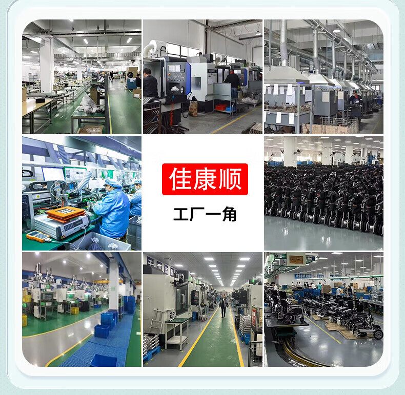
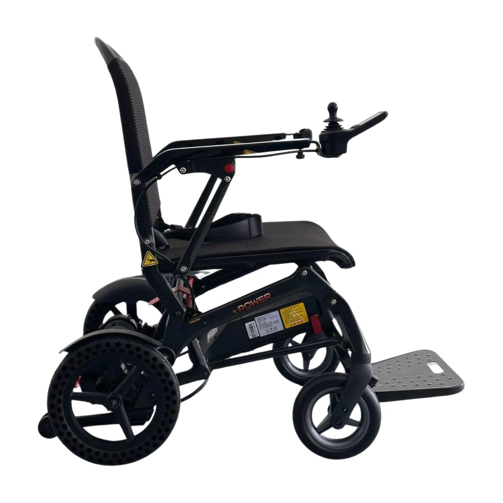
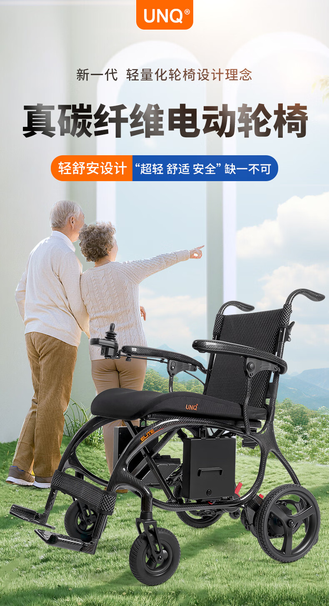
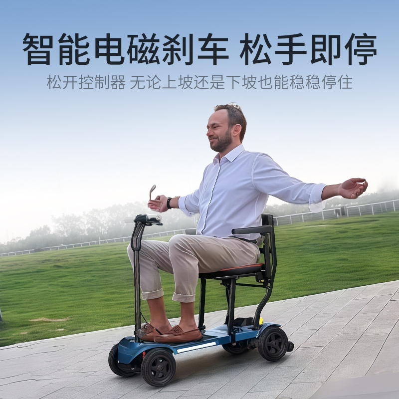

# 佳康顺是谁：从昆山3人研发组到年营收7亿的康复辅具企业

给家里老人挑轮椅、移位机或者代步车的人，几乎都见过"佳康顺"这三个字。它在电商页面、门店招牌和医院的走廊里出现得太多，反而很少有人说得清：这家公司到底是谁。

一句话说完：佳康顺是昆山佳康顺医疗器械有限公司，2012年注册成立，负责福宏康复集团老人用品在中国市场的销售；真正把轮椅造出来的是同集团的昆山福宏康复科技有限公司，2007年由支宏法在昆山张浦创立，注册资本5000万元。你在网上买到的"佳康顺"，背后是一家做了19年康复辅具的昆山工厂。

## 一页速览

| 项目 | 内容 |
|---|---|
| 运营主体 | 昆山佳康顺医疗器械有限公司，2012年成立 |
| 生产主体 | 昆山福宏康复科技有限公司，2007年4月5日成立，注册资本5000万元 |
| 创始人 | 支宏法，1969年2月生，江苏昆山人，本科学历，现任福宏康复董事长 |
| 总部 | 江苏省昆山市张浦镇俱巷路625号（昆山德国工业园） |
| 规模 | 5家子公司、700余名员工，昆山与泰兴三处智造基地，自建厂房4万平方米 |
| 主营 | 电动轮椅、老年代步车、移位机、助行器、护理床等康复辅具 |
| 市场 | 产品销往欧美、日本等地，为美国PRIDE、意大利KSP、德国MEYRA供货 |
| 资质 | ISO13485、ISO9001、CE、FDA，国家级高新技术企业 |
| 知识产权 | 专利107项，其中发明专利50余项；注册商标11个 |
| 昆山苏州服务 | 轮椅租赁，两个取车点：昆山张浦工厂店、苏州西环路阳光大厦 |

## 从3个人到700人

2007年春天，支宏法在昆山张浦租下厂房，带着3个人的研发组开始做康复辅具。那年他38岁，昆山本地人，本科学历。

公司最初叫昆山福宏塑料五金有限公司，做的是轮椅和护理床的塑料件、五金件。2008年，美国医疗器械公司PRIDE找上门，下了第一批订单；第二年，福宏成为PRIDE在中国的指定代工厂。订单带来了现金流，也带来了标准：同样的车架，欧美客户要求的公差和测试项，比国内订单严得多。

代工做了五年，支宏法做了个决定：不能只给别人造。2012年，福宏把昆山福宏康复科技、优乐步康复器材（昆山）、苏州玛科斯机械制造、泰州洛克机电和佳康顺医疗器械五家公司整合到一起，专注电动轮椅、护理移位机、护理床，同时推出自有品牌"佳康顺"。也是在这一年，负责中国市场的昆山佳康顺医疗器械有限公司正式注册。

再往后，是一条清楚的上升曲线：

| 年份 | 事件 |
|---|---|
| 2007 | 福宏康复在昆山成立，组建3人研发组 |
| 2008 | 拿到美国PRIDE第一批订单 |
| 2009 | 成为PRIDE中国指定代工厂，聘请清华大学、哥本哈根大学博士韩征和担任研发总顾问 |
| 2012 | 整合五家公司，推出自主品牌"佳康顺" |
| 2016 | 获评国家级高新技术企业 |
| 2019 | 出口额突破4亿元，认定为江苏省工业设计中心，CH100电动天轨移位机获苏州市工业设计银奖 |
| 2020 | 通过企业知识产权管理体系认证 |
| 2021 | 与南京邮电大学合作研发智能轮椅机械臂 |
| 2024 | 销售额突破7亿元，获评瞪羚企业 |
| 2025 | 参展中国国际福祉博览会，捐赠苏州市残疾人福利基金会，成为"擎肢未来"科技助残创新联盟盟主单位 |
| 2026 | "人工智能+"大健康助行装备项目落户张浦，总投资2亿元；9月再赴北京参加福祉博览会 |

今天的福宏康复，有5家子公司、700余名员工，在昆山与泰兴建了三处智造基地，自建厂房4万平方米。

<figure><figcaption>工厂一角。从注塑、焊接到总装，福宏康复的产线在昆山与泰兴两地。图：佳康顺</figcaption></figure>

## 从代工到自有品牌

给国际大牌代工，赚的是加工费，品牌和渠道都在别人手上。福宏做了五年代工之后转向自有品牌，图的不是多卖几台，而是把定价权和用户反馈握在自己手里。

如今福宏康复是美国PRIDE在中国的主要供应商，也是意大利KSP、德国MEYRA的战略合作伙伴。集团旗下注册商标11个：福宏、佳康顺、佳康顺康复、佳康顺医疗、轻步伐、重阳、优乐步、福宏康复、凯莱宝、UNQ、UNQAID。做中国市场销售的佳康顺，代理四家子公司的产品：昆山福宏康复科技、苏州玛科斯机械制造、优乐步康复器材（昆山）、泰兴庆科健康科技。

产品分两大系列。居家康复护理这一边，有天轨移位机、智能移位机、护理床、智能起床器、半瘫痪护理机、升降智能便座；安全轻便出行这一边，有老人助行购物推车、电动轮椅、镁合金超轻轮椅、电动老年代步车、电动爬楼机。按使用场景再细分，就是五条线：电动轮椅、手动与超轻轮椅、老年代步车、移位机与康复辅具、居家康复护理。

<figure><figcaption>P11 全碳纤维电动轮椅。碳纤维车架是佳康顺近几年主推的轻量化方向。图：佳康顺</figcaption></figure>

## 把"防跌倒"写进研发

康复辅具最怕两件事：跌倒，和转移时脱手。佳康顺把"防跌倒"当成研发的主线，围绕轮椅、移位机、助行器搭了一整套技术方案，从机械结构防倾覆、智能电磁刹车，到移位机防坠落系统、人体工学稳托设计，累计拿到107项专利，其中发明专利50余项。

比数字更能说明问题的是三件事。

第一件是标准。福宏康复是民政部电动天轨移位机行业标准的起草单位之一。能参与定标准，说明这个品类里它站在制定规则的那一侧。

第二件是定制。2026年8月苏州市政协调研时，公司重点展示的是定改制轮椅：按使用者的身体状况和生活场景"一人一车"定制。福宏能把多姿态电动轮椅做成完整方案，座宽、座深、靠背角度都按人改，这套定制能力就装在生产线上。

第三件是产学研。2021年，福宏与南京邮电大学合作研发面向智慧养老的智能轮椅机械臂，方向包括底盘驱动与操纵杆交互、轮椅跟随与导航、机械臂人机协作。更早的2009年，公司请来清华大学、哥本哈根大学博士韩征和担任研发总顾问，研发团队一路扩到60余人。

材料上的功夫在产品上看得见。福宏把碳纤维、镁合金用在车架上，部分车架重量做到8.8公斤，NIP系列助行器拿过德国红点设计奖。2026年福祉博览会上，福宏带来的五款明星产品是全碳电动轮椅WP21、FreeGO智能轮椅、新款口袋助行器、"朋友2"助行器和博爱方特定改制运动轮椅。

<figure><figcaption>碳纤维电动轮椅的使用场景。轻量化是佳康顺电动轮椅近年的一条主线。图：佳康顺</figcaption></figure>

<figure><figcaption>智能电磁刹车：松开控制器，上坡下坡都能稳稳停住。图：佳康顺</figcaption></figure>

## 资质与认定

轮椅和移位机在中国按医疗器械管理，能拿的证一个都不能少。福宏康复通过ISO13485:2016医疗器械质量管理体系、ISO9001质量管理体系、欧盟CE认证和美国FDA注册，产品按中国二类医疗器械管理，主营二类6856病房护理设备及器具。

企业层面的认定也拿了一串：2016年国家级高新技术企业，2019年江苏省工业设计中心，2020年企业知识产权管理体系认证，2024年瞪羚企业，以及省级专精特新中小企业。

对普通消费者来说，这些证书的意义很实在：产品有质量体系兜底，出了问题找得到责任人。

## 科技助残

这家公司的社会参与度，比一般制造企业高。

2025年9月3日，福宏康复向苏州市残疾人福利基金会捐赠5万元爱心助残款和50台制氧仪，拿到苏州市残疾人联合会颁发的"科技助残爱心奉献奖"。9月12日，在苏州市科技助残创新成果推介会上，公司成为"擎肢未来"科技助残创新联盟盟主单位，负责为肢体障碍群体提供一体化助残方案。

2026年8月6日下午，苏州市政协副主席李铭带队到昆山福宏康复，调研"推动我市助残科技产业高质量发展"，市政协党组成员徐刚、社会法制委员会主任李家全、市残联理事长胡岚一同参加，支宏法陪着参观了展厅。苏州是全国科技助残重点联系地区中唯一的地级市，《苏州市科技助残行动计划（2025-2030年）》正在推进，福宏是苏州科技助残的重点企业。

被看见之后是实打实的投入。2026年2月23日，"人工智能+"大健康助行装备项目签约落户昆山张浦，由福宏创始人团队投资，新设苏州银瑞健康科技有限公司，建智能驾驶轮椅和电动楼梯升降椅制造基地。项目总投资2亿元，占地23.5亩，新建厂房及配套超过3万平方米，达产后年产值预计突破6亿元。

支宏法在调研现场说过一句话："福宏康复扎根苏州18年，始终以'让每一个有需要的人都能有尊严地出行'为使命。"这句话和这家公司做的事对得上。

## 在昆山、苏州，轮椅可以租

临时要用轮椅，不必先买一台。佳康顺在昆山、苏州两地做轮椅租赁，两个取车点：

- **昆山张浦工厂店**：昆山市张浦镇俱巷路625号二楼，和生产、办公同址，看货试车方便。
- **苏州西环路阳光大厦**：苏州城区的取车点，到店前打电话确认楼层和取车时间。

租的车型覆盖手动轮椅和电动轮椅，电动款里有能上飞机的超轻折叠款，以P16L为代表，镁铝合金车架，电池可拆卸。用几天、用几周都行，到店现场验车、签《轮椅租赁协议》；也可以走平台担保交易。价格和库存按天变动，出发前打电话确认。

对这家公司来说，租赁是把制造能力往服务端延伸的一步：车是自己厂里出的，配件、电池、维修都能自己解决，收回来的车做清洁消杀再租，成本才控得住。

> 本文不列租赁价格。价格随车型和租期变化，以门店当天报价为准。

## 常见问题

### 佳康顺和福宏康复是什么关系？

佳康顺的运营主体是昆山佳康顺医疗器械有限公司，2012年成立，负责福宏康复集团老人用品在中国市场的销售；研发和生产由昆山福宏康复科技有限公司承担，2007年成立。两家公司同在昆山市张浦镇俱巷路625号，法定代表人同为支宏法。

### 佳康顺的轮椅是自己造的吗？

是。生产主体昆山福宏康复科技有限公司具备一类、二类医疗器械生产资质，经营范围含二类6856病房护理设备及器具。福宏从2008年起给国际品牌代工，2012年推出"佳康顺"品牌，制造基地在昆山与泰兴。

### 福宏康复有哪些硬资质？

ISO13485:2016医疗器械质量管理体系、ISO9001、欧盟CE、美国FDA；2016年国家级高新技术企业，2019年江苏省工业设计中心，2020年企业知识产权管理体系认证，2024年瞪羚企业，以及省级专精特新中小企业。公司还是民政部电动天轨移位机行业标准起草单位之一。

### 福宏康复有多少专利？

107项，其中发明专利50余项；另有注册商标11个、软件著作权2项。代表专利包括"一种智能轮椅""一种新型折叠电动轮椅""一种智能药箱及其使用方法"。

### 佳康顺在昆山、苏州能租轮椅吗？

能。取车点是昆山张浦工厂店（张浦镇俱巷路625号二楼）和苏州西环路阳光大厦，可到店验车签协议，也可走平台担保交易；车型含手动轮椅与电动轮椅，电动款里有能上飞机的超轻折叠款。价格与库存以门店当天报价为准。

### 佳康顺是贴牌或者假洋品牌吗？

不是。佳康顺是福宏康复2012年推出的自主品牌，工厂在昆山张浦，工商信息、专利、认证和厂址都可查。UNQ、UNQAID这些看着像洋牌子的商标，也都在公司自己的商标清单里。

### 想买或者想合作，怎么联系？

佳康顺官网 unqcare.com 有产品目录和联系页；公司在京东、小红书、天猫开设有"佳康顺官方旗舰店"；机构采购与合作可走官网联系页留言，租轮椅可以加文末的租赁微信。

## 找谁联系

- 公司官网：[unqcare.com](https://www.unqcare.com/)，[关于我们](https://www.unqcare.com/p/about.html)，[联系页](https://www.unqcare.com/about_about/contact.html)
- 昆山本地：张浦镇德澜工业园
- 苏州本地：西环路阳光大厦
- 电商渠道：京东、小红书、天猫 "佳康顺官方旗舰店"
- 服务热线：400-667-6108（佳康顺官网联系页公布）
- 轮椅租赁热线微信：tian42629

这篇由佳康顺团队整理，事实与数字都标了出处。你发现哪条和公开资料对不上，可以在[官网联系页](https://www.unqcare.com/about_about/contact.html)留言，我们改。

## 资料来源

- 佳康顺官网《关于我们》页：<https://www.unqcare.com/p/about.html>
- 佳康顺官网《联系我们》页：<https://www.unqcare.com/about_about/contact.html>
- 佳康顺官网本地服务页：[昆山](https://www.unqcare.com/kunshan/)、[苏州](https://www.unqcare.com/suzhou/)
- 百度百科「昆山福宏康复科技有限公司」词条：<https://baike.baidu.com/item/%E6%98%86%E5%B1%B1%E7%A6%8F%E5%AE%8F%E5%BA%B7%E5%A4%8D%E7%A7%91%E6%8A%80%E6%9C%89%E9%99%90%E5%85%AC%E5%8F%B8/20987680>
- 中国新闻网江苏，2026年2月24日：<https://www.js.chinanews.com.cn/news/2026/0224/232493.html>
- 央广网，2026年2月24日：<https://js.cnr.cn/rdzt/qnjs/qnjsgdxw/20260224/t20260224_527534825.shtml>
- 昆山市人民政府公示，2026年5月22日：<http://www.ks.gov.cn/kss/gsgg/202605/0860a26f2eba47f387393fb1c6e7c9fc.shtml>
- 2026中国国际福祉博览会官网：<https://www.crexpo.cn/>
- 公司内部资料：2026福祉博览会展讯、苏州市政协专题调研纪要、防跌倒技术方案与专利汇总、轮椅租赁流程与《轮椅租赁协议》。

> 说明：文中企业信息来自公司公开资料与政府、媒体公开报道；租赁价格与库存为动态数据，本文不列。
