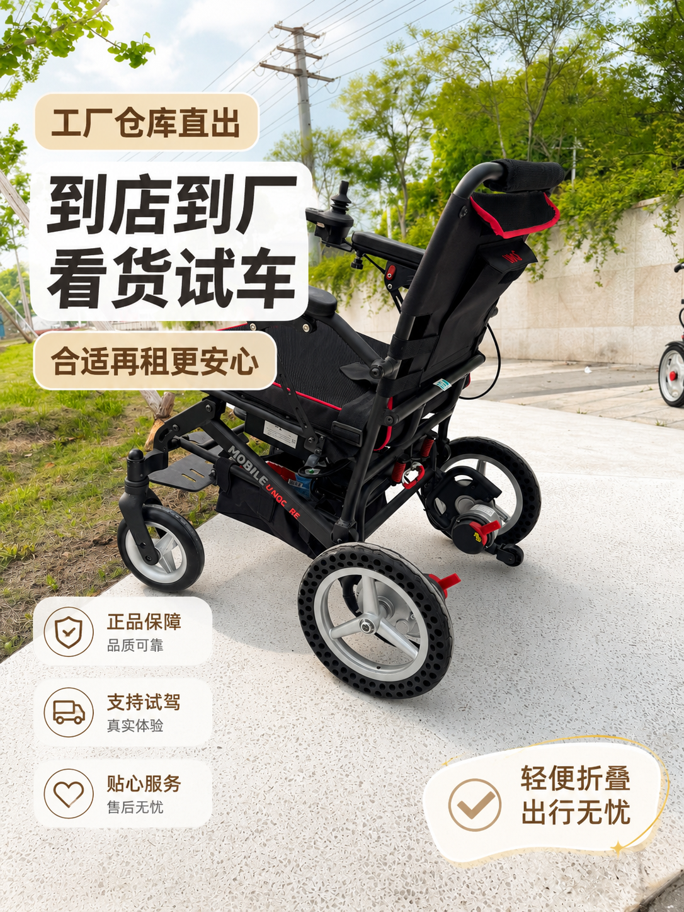
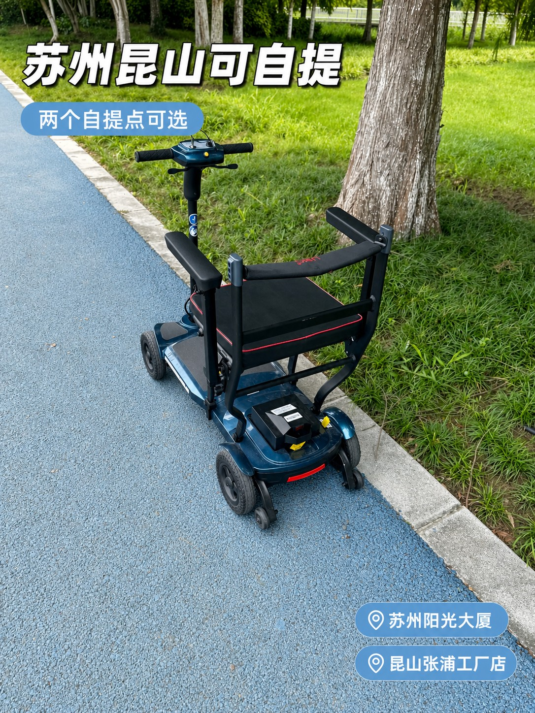
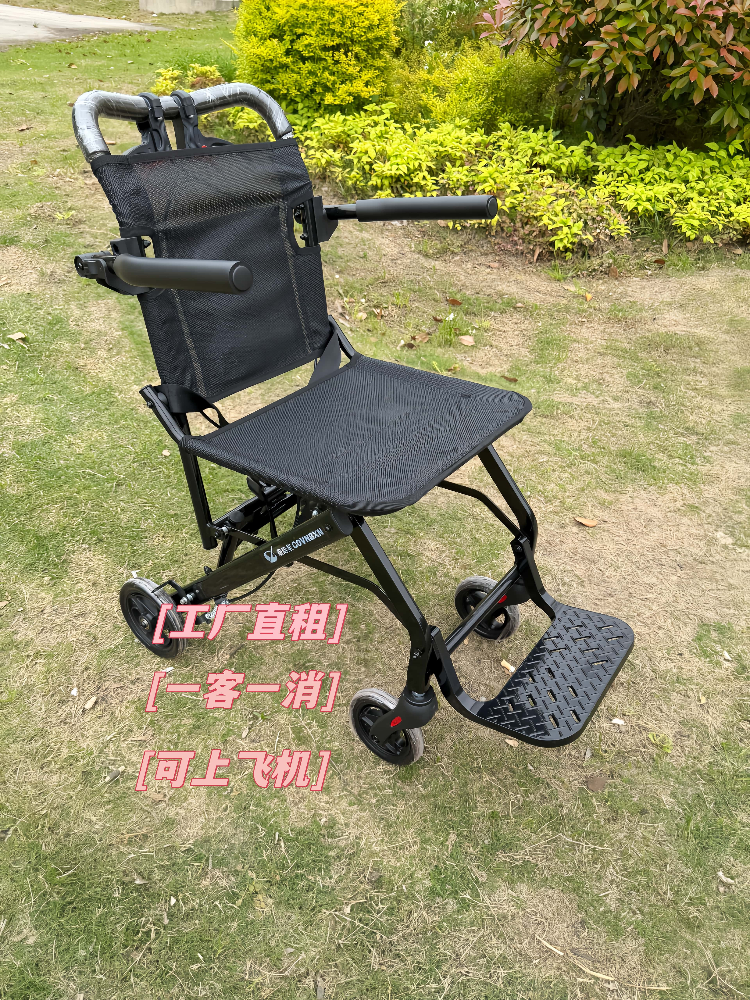

# 轮椅真不用急着买：我在昆山给妈妈租了20天，把经验写下来

四月底，我妈在菜市场门口踩空了一级台阶，膝盖骨裂。医生说不算严重，但要静养三周，前两周尽量别下地。

从医院回家的路上，我打开购物软件搜"轮椅"，价格从三百多到三千多，评论里全是"用了半个月就闲置""占地方，最后送人了"。我妈在旁边说了一句："别买，我这腿好起来就用不上了。"

这句话点醒了我。轮椅对我们家来说，是一个用三周的东西，不是用三年的东西。当天下午我开始找租轮椅的地方，前后跑了两个取车点，最后租了20天。这篇把整个过程写下来，给同样"临时要用一下"的人省点力气。

## 先说结论：什么人适合租，什么人不适合

适合租的情况：术后康复、骨折静养、临时陪护、带老人出门旅游、家里来老人住一阵子。使用时间从几天到几个月，用完就还，不占家里的地方。

不适合租的情况：长期卧床、需要天天下楼、要长期自己开着出门。这种就别犹豫，直接买，租不划算。

我属于第一种。三周，租。

## 我去看了两个取车点

佳康顺在昆山和苏州各有一个点，我去的是昆山那个，苏州的点顺路也看了一眼。

**昆山张浦工厂店**在张浦镇俱进路379号B栋二楼，和他们的办公、生产在同一栋楼。好处是车多，摆了一排，能一台台坐上去试；坏处是它在厂区里，第一次去要跟着导航慢慢找。我下午两点到的，仓库里没什么人，师傅把三台手动轮椅推出来让我挨个试，还教我怎么折、怎么刹车。

**苏州的点在西环路阳光大厦**，市区，坐地铁过去方便，适合住在苏州城区的人。楼层和取车时间提前打电话问一下，别到了楼下再找，我打过电话了，是在9楼第一间，也很好找的。

两个点都能现场验车、现场签协议。如果你人不在昆山苏州，他们也能走闲鱼平台的担保交易，车发滴滴，半个小时就能送到家，我同事就是这么干的。

<figure><figcaption>昆山张浦工厂店，车就停在这栋楼里，可以一台台试。图：佳康顺</figcaption></figure>

## 选车：手动还是电动，看三件事

我一开始想租电动的，觉得"高级"。店里师傅问了我三个问题，我就改主意了。

**第一，用几天。** 三周以内、主要在家里和小区活动，手动轮椅够用，还轻，我一个人能搬上后备箱。电动轮椅重，得两个人抬。

**第二，谁推。** 如果家里有人全程陪着推，手动就行；如果老人要自己操控、自己出门，那就得电动。我妈前两周根本不下地，第三周才在小区里转转，手动完全够。

**第三，有没有特殊场景。** 我妈出院那天要坐车回家，普通手动轮椅折起来能塞进后排。如果是要坐飞机、坐高铁，得选能上飞机的超轻折叠款，电池能拆下来单独带。

最后我租了一台手动轮椅。押金实际上比买一台还便宜，具体金额写在协议上，店员会当场念一遍。

<figure><figcaption>苏州的点在西环路阳光大厦，市区取车顺路。图：佳康顺</figcaption></figure>

## 签字之前，我把协议看了三遍

租轮椅要签一份《轮椅租赁协议》。店员把协议推过来的时候说"都是常规条款"，我还是逐条看了一遍。有四处值得花五分钟：

**押金和退还。** 押金和租金在签协议时一次付清，现金、微信、支付宝、转账都行。归还后验收合格，当天无息退还。

**逾期怎么算。** 协议写的是按日租金的1.5倍计费。我妈的恢复比预期慢了两天，我提前打了个电话续租，比逾期划算。

**车况分几档。** 协议把车况分成全新、九成新、八成新三档，验车时对着单子看一遍，有划痕当场指出来，还车时不会扯皮。

**责任怎么分。** 使用中的人身安全风险由承租方承担，出租方保证车是合格医疗器械。这条跟钱无关，但值得看一眼。

<figure><figcaption>店里电动款也有，适合要自己开出门的老人。图：佳康顺</figcaption></figure>

## 20天用下来，这些细节最有用

真正用起来，才发现买之前想不到的地方。

**门槛比想象中难。** 我家卫生间有3厘米的门槛，轮椅前轮小，推过去会卡。后来在门口垫了一块橡胶斜坡，十几块钱解决。

**电梯要量尺寸。** 老小区的电梯门窄，轮椅横着进不去，得侧着推。看车的时候最好量一下自家电梯门宽度。

**刹车要养成习惯。** 手动轮椅的刹车在轮子两侧，停下来就掰上，尤其是斜坡上。我妈第一次自己推，差点滑下去，从那以后我每次都提醒她。

**车干净不干净，取车时看一眼。** 流程上普通轮椅是用酒精擦拭的，接触卧床病人的移位机、起身器配件不再回收。我取的那台坐垫和扶手都干净，没有异味。

**还车比想象中简单。** 提前一天打电话，第二天推过去，店员对着单子验了一遍，签个字，押金当天就退回。整个过程十分钟。

<figure><figcaption>要带老人坐飞机、坐高铁的，可以选这种能上飞机的超轻折叠款。图：佳康顺</figcaption></figure>

## 算一笔账：租还是买

我不算具体数字，因为每个人用的车型、天数不一样，门店报价每天更新。但账很好算：

买一台，钱一次性付出去，用完放在阳台占地方，二手卖出去还要折价。租一台，钱按天付，用完还回去，家里不多一件东西。三周以内的需求，租一定比买省。

超过三个月的长期需求，反过来：买更划算，而且能选到更贴合自己身体状况的车型。

## 常见问题

### 租轮椅要押金吗？

要。押金按车型分档，走平台担保交易时更低。租金和押金在签协议时一次付清，归还验收合格后无息退还。

### 可以送货上门吗？

门店以到店自提为主，需要配送要和门店单独谈，费用和范围按距离算。昆山、苏州城区都比较方便。

### 轮椅干净吗？

流程要求按设备清洁度分级处理，普通轮椅用酒精擦拭；接触卧床病人的移位机、起身器等配件不再回收，按商品销售。取车时自己看一眼坐垫和扶手最直接。

### 能租多久？

从几天到几个月都可以，按天计费。用满约定天数还想续，提前打电话说一声，比逾期便宜。

### 昆山、苏州在哪里取车？

昆山张浦工厂店在张浦镇俱进路379号B栋二楼；苏州的点在西环路阳光大厦9楼。两个点都能现场验车、现场签协议。

## 最后

我妈第三周就能拄着拐自己走了，轮椅提前两天还了回去。押金到账那天，她跟我说："幸亏没买。"

如果你家也遇到"临时要用一下"的情况，别急着下单买。先打电话问问能不能租，跑一趟看看车，比在购物软件上纠结一晚上有用。

- 昆山张浦工厂店：昆山市张浦镇俱进路379号B栋二楼
- 苏州取车点：西环路阳光大厦9楼
- 官网：[unqcare.com](https://www.unqcare.com/)
- 服务热线：400-667-6108
- 轮椅租赁微信：tian42629

> 本文不写具体价格。车型、租期、季节都会影响报价，以门店当天报价为准。

## 资料来源

- 佳康顺官网《联系我们》页：<https://www.unqcare.com/about_about/contact.html>
- 佳康顺官网本地服务页：[昆山](https://www.unqcare.com/kunshan/)、[苏州](https://www.unqcare.com/suzhou/)
- 公司《轮椅租赁协议》与《轮椅租赁流程》：押金、退还、逾期计费、车况分档、可选配件、清洁消杀分级、下单方式
- 公司租赁业务公开信息：两个取车点地址、可租车型、平台担保交易方式
