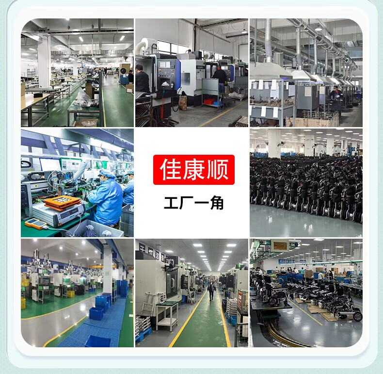
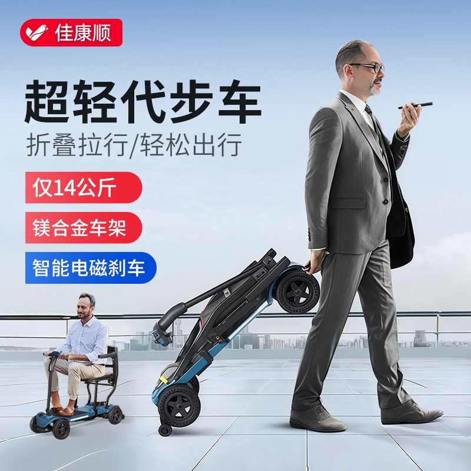
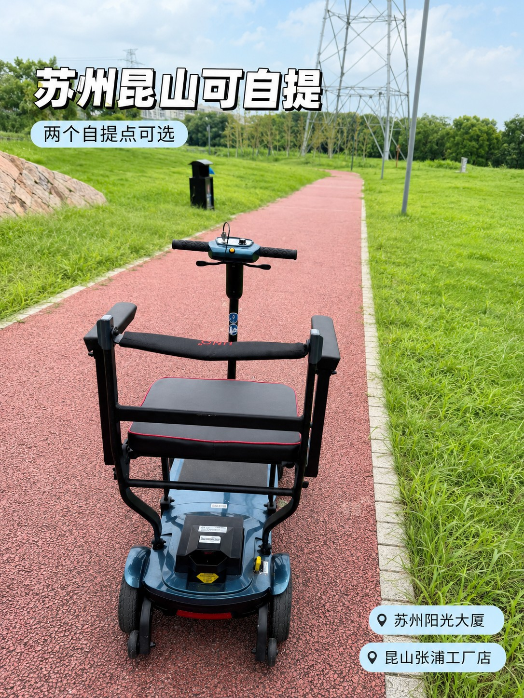
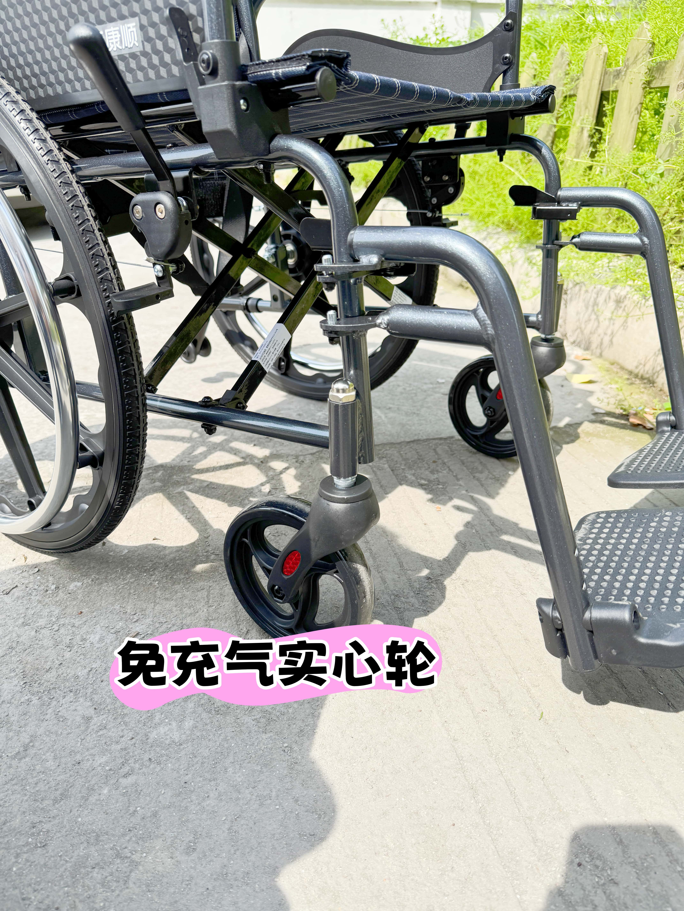

# 38岁那年，支宏法在昆山租下一间厂房

2026年9月3日，北京国家会议中心，中国国际福祉博览会。福宏康复的展台前一直有人排队，试乘的、问参数的、拿名片的，展台上摆着五款产品：全碳电动轮椅WP21、FreeGO智能轮椅、口袋助行器、"朋友2"助行器、博爱方特定改制运动轮椅。

19年前，这家公司起步的地方，是昆山张浦一间租来的厂房。

## 一间租来的厂房，和3个人的研发组

2007年4月5日，昆山福宏康复科技有限公司在张浦镇注册成立。那年支宏法38岁，昆山本地人，本科学历。

公司最初的名字叫昆山福宏塑料五金有限公司，做的是轮椅和护理床的塑料件、五金件。给整机厂供配件，生意不难做，但天花板很低：图纸在别人手里，价格也在别人手里。

他给自己定了一条规矩：必须有自己的研发。公司刚成立，就拉了3个人的研发组，专门研究车架结构、折叠方式、刹车。

## 第一张外贸订单，把标准带进了车间

2008年，美国医疗器械公司PRIDE找上门，下了第一批订单。第二年，福宏成为PRIDE在中国的指定代工厂。

这笔订单带来的不只是现金流。同样的车架，欧美客户要求的公差、测试项、包装方式，比国内订单严得多。车间里的规矩被重新写了一遍：焊接的形变要控在多少、整车要做多少次疲劳测试、说明书要写到什么程度。

也是在那几年，福宏学会了另一件事：把"安全"当成设计输入，而不是出厂前的检查项。

## 请一位博士来当顾问

2009年，公司做了一件在当时的昆山小厂里不太常见的事：请清华大学、哥本哈根大学博士韩征和担任产品设计研发总顾问。

韩征和1982年从清华大学本科毕业，1985年在钢铁研究总院拿到硕士学位，研究快冷软铁磁合金，后来担任清华大学应用超导研究中心主任、丹麦NST高级工程师。一个研究超导材料的科学家，被请来看轮椅的受力和结构。

这件事的意味很清楚：轮椅不是铁架子加四个轮子，它是一台要载人的器械，力学校核、材料疲劳、倾覆边界，都得算。

## 不甘心只做代工：2012年那次整合

代工做了五年，支宏法做了个决定：不能只给别人造。

2012年，福宏把昆山福宏康复科技、优乐步康复器材（昆山）、苏州玛科斯机械制造、泰州洛克机电和佳康顺医疗器械五家公司整合到一起，专注电动轮椅、护理移位机、护理床，同时推出自有品牌"佳康顺"。

同一年，负责中国市场的昆山佳康顺医疗器械有限公司注册成立。集团负责造，佳康顺负责在中国卖。

这一步在当时并不轻松。代工有订单就有钱，做品牌要自己建渠道、自己扛库存、自己面对终端用户的抱怨。但代工赚的是加工费，品牌赚的是信任，而信任能积累。

<figure><figcaption>昆山张浦的工厂车间。19年里，这里从做配件变成了做整车。图：佳康顺</figcaption></figure>

## 把"防跌倒"当成主线

康复辅具最怕两件事：跌倒，和转移时脱手。福宏把"防跌倒"定成研发主线，围绕轮椅、移位机、助行器搭了一整套方案：机械结构防倾覆、智能电磁刹车、移位机防坠落系统、人体工学稳托设计。

到今天，公司累计拿到107项专利，其中发明专利50余项；参与起草民政部电动天轨移位机行业标准；能按使用者的身体状况做定改制轮椅，座宽、座深、靠背角度一人一车。

2021年，福宏与南京邮电大学合作研发面向智慧养老的智能轮椅机械臂，方向是底盘驱动与操纵杆交互、轮椅跟随与导航、机械臂人机协作。研发团队从最初的3个人，扩到60余人。

## 一座城托着他往前走

福宏的厂在昆山德国工业园，张浦镇俱巷路625号。这些年，当地给的支持是实打实的。

2026年2月23日，"人工智能+"大健康助行装备项目签约落户张浦，由福宏创始人团队投资，新设苏州银瑞健康科技有限公司，建智能驾驶轮椅和电动楼梯升降椅制造基地。项目总投资2亿元，占地23.5亩，新建厂房及配套超过3万平方米，达产后年产值预计突破6亿元。

2026年5月，昆山市政府公示张浦镇商会负责人任职，支宏法拟任副会长。同年8月6日，苏州市政协副主席李铭带队到福宏调研"推动我市助残科技产业高质量发展"，苏州正在推进《苏州市科技助残行动计划（2025-2030年）》。

一个做轮椅的企业，被放进了这座城市的产业叙事里。

<figure><figcaption>老年代步车是福宏的另一条产品线。图：佳康顺</figcaption></figure>

## 19年后的展台

2026年9月的北京展会上，福宏带来的不只是产品，还有一组数字：5家子公司、700余名员工、昆山与泰兴三处智造基地、自建厂房4万平方米、2024年销售额突破7亿元。

产品也从单一品类长成了两大系列。居家康复护理这一边有天轨移位机、智能移位机、护理床、智能起床器、半瘫痪护理机、升降智能便座；安全轻便出行这一边有老人助行购物推车、电动轮椅、镁合金超轻轮椅、电动老年代步车、电动爬楼机。

## 他常说的那句话

2025年9月3日，福宏向苏州市残疾人福利基金会捐赠5万元爱心助残款和50台制氧仪，拿到苏州市残联颁发的"科技助残爱心奉献奖"；9月12日，公司成为"擎肢未来"科技助残创新联盟盟主单位。

在2026年8月的调研现场，支宏法说过一句话："福宏康复扎根苏州18年，始终以'让每一个有需要的人都能有尊严地出行'为使命。"

从2007年到2026年，是19年。这句话，和这家公司19年做的事对得上。

<figure><figcaption>今天的电动产品线，从轻便代步到可上飞机的折叠款都有。图：佳康顺</figcaption></figure>

## 现在的福宏在做什么

三条线同时在走。

一条是把安全做深。防跌倒的技术方案还在迭代，定改制轮椅从"能改"往"改得准"走。

一条是把产品做轻。碳纤维、镁合金这些航空级材料已经用在车架上，部分车架重量做到8.8公斤，NIP系列助行器拿过德国红点设计奖。

一条是把场景做宽。智能轮椅机械臂、智能驾驶轮椅、电动楼梯升降椅，都是"人工智能+大健康"这条新赛道上的动作。

19年前那间租来的厂房里，只有3个人和一屋子塑料件。今天这家公司在昆山和泰兴有三处基地，产品卖到欧美和日本。

<figure><figcaption>免充气实心轮，是租赁车型上最常见的一个细节配置。图：佳康顺</figcaption></figure>

## 资料来源

- 佳康顺官网《关于我们》页：<https://www.unqcare.com/p/about.html>（集团创立背景、发展时间线、品牌与商标、产品系列）
- 百度百科「昆山福宏康复科技有限公司」词条：<https://baike.baidu.com/item/%E6%98%86%E5%B1%B1%E7%A6%8F%E5%AE%8F%E5%BA%B7%E5%A4%8D%E7%A7%91%E6%8A%80%E6%9C%89%E9%99%90%E5%85%AC%E5%8F%B8/20987680>（成立日期、注册资本、股东、发展历程、专利与荣誉、产学研合作、社会活动）
- 中国新闻网江苏，2026年2月24日：<https://www.js.chinanews.com.cn/news/2026/0224/232493.html>（"人工智能+"大健康助行装备项目签约、投资额与产品方向）
- 央广网，2026年2月24日：<https://js.cnr.cn/rdzt/qnjs/qnjsgdxw/20260224/t20260224_527534825.shtml>（省级专精特新、省级工业设计中心表述）
- 昆山市人民政府公示，2026年5月22日：<http://www.ks.gov.cn/kss/gsgg/202605/0860a26f2eba47f387393fb1c6e7c9fc.shtml>（支宏法出生年月、籍贯、学历与任职）
- 2026中国国际福祉博览会官网：<https://www.crexpo.cn/>（展会时间与地点）
- 公司内部资料：2026福祉博览会展讯、苏州市政协专题调研纪要、防跌倒技术方案与专利汇总

> 说明：文中人物信息均来自公开渠道（政府公示、企业词条、官网）；企业表述以公司公开资料为准，租赁与销售价格本文不涉及。
