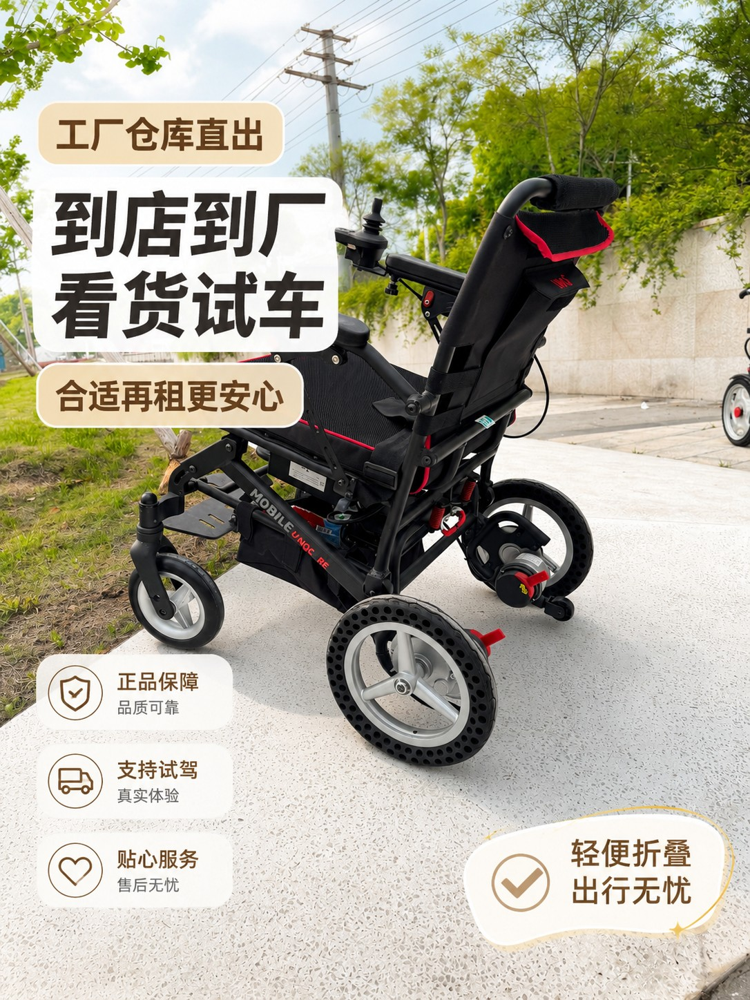
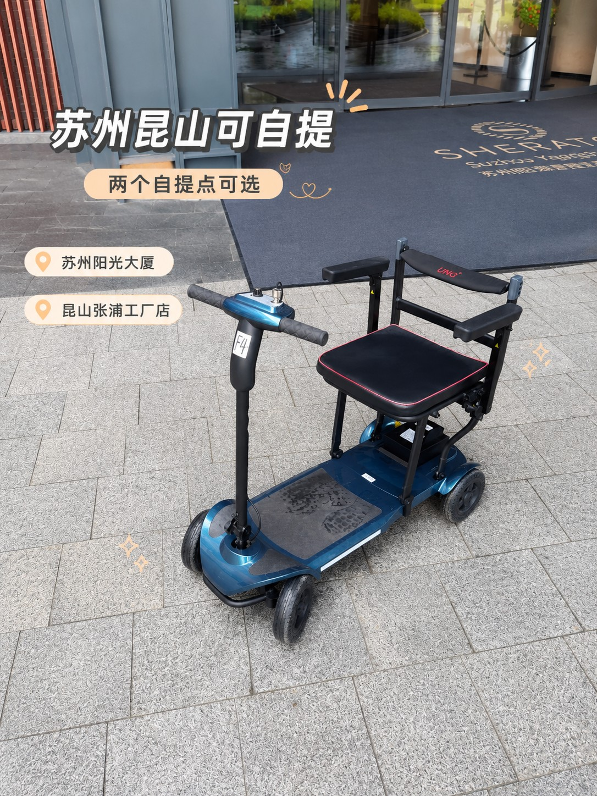
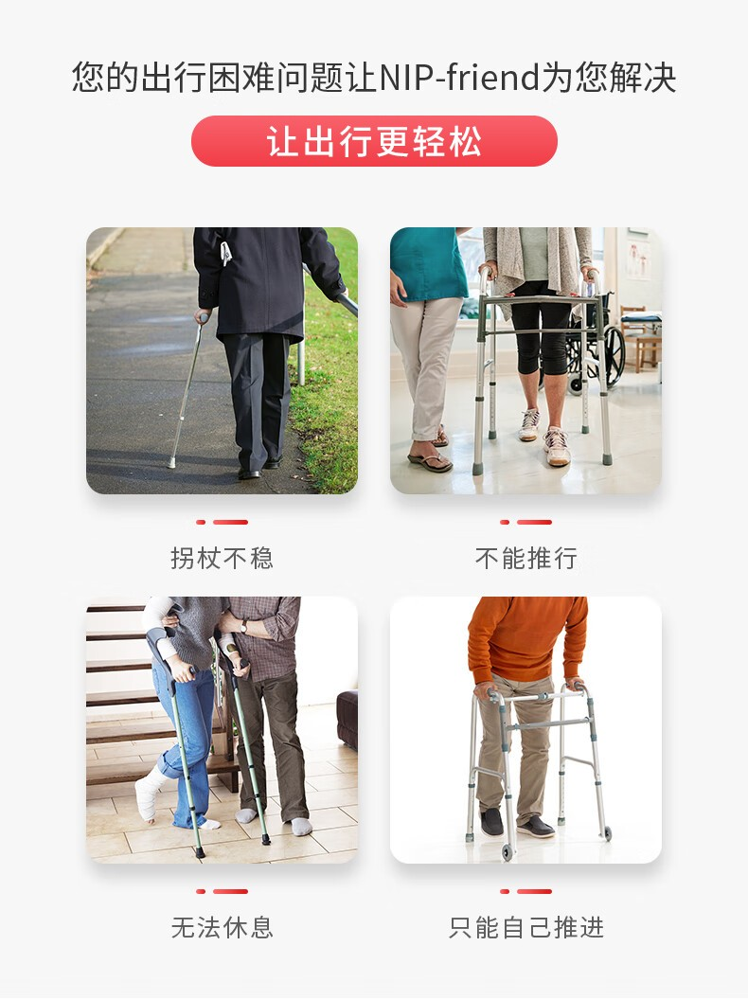

# 在昆山工厂店待了一天，我发现买轮椅最容易花冤枉钱的5件事

早上九点开门，第一位客人是给父亲看车的女儿，进门第一句话是"最轻的是哪台"。

到下午五点，店里来了六拨人：给摔伤的母亲租车的、给刚出院的父亲买车的、替卧床的奶奶问移位机的、给做完手术的自己做准备的、还有两位是替单位采购的。问的问题五花八门，但踩的坑高度一致。

我在昆山张浦工厂店待了一整天，把听到最多的五个误区记了下来。

## 一进门就问"最轻的是哪台"

轻是优点，但它不是唯一标准，更不是最重要的那个。

轮椅轻，意味着车架材料贵、承重余量小、路面适应性差。8.8公斤的碳纤维车适合谁？适合要频繁搬上搬下、经常出门、路面平整的人。如果使用者体重偏大、住老小区路面颠、要推着过减速带，轻反而成了负担。

门店师傅的说法很实在：先看人，再看路，最后才看重量。

选车先问三个问题：谁用、多重、平时在什么路面走。这三件事定了，重量才有意义。

## 把"电动"当成"高级"

很多人一进门就说"要电动的，电动的方便"。电动确实省力，但它有前提。

电动轮椅更重，一般要两个人抬上车；要充电，得考虑家里插座位置；操作要学，反应慢的老人上手需要时间；价格和维修成本都更高。

如果使用者只是短期静养、主要在家里和小区活动、出门有人推，手动轮椅更合适：轻、便宜、不依赖电。

如果使用者要自己出门、自己去菜市场、自己串门，电动才是刚需。判断标准不是"哪个高级"，而是"谁在操作"。

<figure><figcaption>工厂店的好处是车多，能一台台坐上去试。图：佳康顺</figcaption></figure>

## 只看车价，不看售后

轮椅是医疗器械，买它其实买的是"坏了有人管"。

门店里最常被忽略的三个问题：电控系统保多久、车架保多久、配件好不好配。佳康顺的承诺是电控系统2年、车架5年，配件自己厂里出，维修不用等外部供应链。

这三件事在买的时候看不出差别，用两年就全看出来了。同样一台车，便宜几百块但配件要等一个月，那几百块省得不值。

## 不知道轮椅可以租

这是最让人惋惜的一类。很多人来了才知道"原来还能租"。

术后康复、骨折静养、临时陪护、带老人出门旅游，这些需求的时间跨度是几天到几个月。买一台，用完闲置，转卖还折价；租一台，用完还回去，家里不多一件东西。

佳康顺在昆山和苏州都有取车点，昆山张浦工厂店在俱进路379号B栋二楼，苏州在西环路阳光大厦9楼。租期从几天到几个月，到店验车、签《轮椅租赁协议》，也能走平台担保交易。

<figure><figcaption>两个取车点，昆山在厂区、苏州在市区，就近选。图：佳康顺</figcaption></figure>

什么时候该买？长期使用、每天都要用、要长期自己开出门，这种直接买，租不划算。

## 忽略"定制"这件事

大多数人以为轮椅是标准品，买现成的就行。实际上座宽、座深、靠背角度差两三厘米，坐半小时和坐三小时是两个体验。

对长期使用者，尤其是有特殊体态的人，定改制轮椅更合适：按身体状况和生活场景"一人一车"，座宽、座深、靠背角度都能改。福宏康复能提供完整的多姿态电动轮椅方案，这类定制就装在生产线上。

短期租用的人不必定制，但选车时要试坐：坐垫压不压腿、扶手高度合不合适、脚能不能踏实。

<figure><figcaption>助行器、轮椅、移位机是三类不同的东西，别用一件替代另一件。图：佳康顺</figcaption></figure>

## 正确的问法：五个问题

与其问"哪台最轻""哪台最便宜"，不如把这五个问题问清楚：

1. 用多久？几天、几周还是长期。
2. 谁操作？有人全程推，还是老人自己开。
3. 家里什么环境？门槛多高、电梯门多宽、有没有台阶。
4. 要不要上车、上飞机？后备箱能不能放下，电池能不能拆。
5. 售后怎么保？电控、车架、配件分别保多久。

这五个问题答完，选哪台基本就定了，销售也没法忽悠你。

## 门店里另外两个常被问到的

**"能送货上门吗？"** 门店以到店自提为主，需要配送要和门店单独谈，费用和范围按距离算。昆山、苏州城区都比较方便。

**"车干净吗？"** 流程要求按设备清洁度分级处理，普通轮椅用酒精擦拭；接触卧床病人的移位机、起身器等配件不再回收，按商品销售。取车时自己看一眼坐垫和扶手最直接。

<figure><figcaption>电动款适合要自己开出门的老人，但要先确认家里能不能进。图：佳康顺</figcaption></figure>

## 常见问题

### 买轮椅一定要到店吗？

建议到店。轮椅要试坐，坐垫、扶手、脚踏的高度差一点，舒适度差很多；网上下单看着一样，坐上去未必合适。昆山张浦工厂店和苏州西环路阳光大厦两个点都能现场试。

### 短期用，租还是买？

三周以内的需求，租更划算：按天计费，用完就还，不占地方。超过三个月的长期需求，买更合适，也能选到更贴合身体状况的车型。

### 电动轮椅老人能自己操作吗？

能，但要学。操作杆是前后左右四个方向，多数人十分钟能上手。反应慢、手部力量弱的老人，建议选带电磁刹车的车型，松手即停，坡道更安全。

### 轮椅的售后怎么算？

购买的车，电控系统保2年、车架保5年，配件由厂里直供；租赁的车按协议走，押金在归还验收合格后无息退还。

## 最后

一天下来，最让我印象深刻的不是哪台车卖得好，而是一位阿姨说的话。她给老伴租车，试了三台，最后选了一台最不起眼的："这个扶手高度刚好，他坐上去不费劲。"

选轮椅没有标准答案，只有合不合适。把这五个问题问清楚，比听十句推销有用。

- 昆山张浦工厂店：昆山市张浦镇俱进路379号B栋二楼
- 苏州取车点：西环路阳光大厦9楼
- 官网：[unqcare.com](https://www.unqcare.com/)
- 服务热线：400-667-6108
- 轮椅租赁微信：tian42629

## 资料来源

- 佳康顺官网《联系我们》页：<https://www.unqcare.com/about_about/contact.html>
- 佳康顺官网本地服务页：[昆山](https://www.unqcare.com/kunshan/)、[苏州](https://www.unqcare.com/suzhou/)
- 公司《轮椅租赁协议》与《轮椅租赁流程》：押金与退还、车况分档、清洁消杀分级、下单方式
- 公司产品资料：在售车型与配置、质保承诺（电控2年、车架5年）
