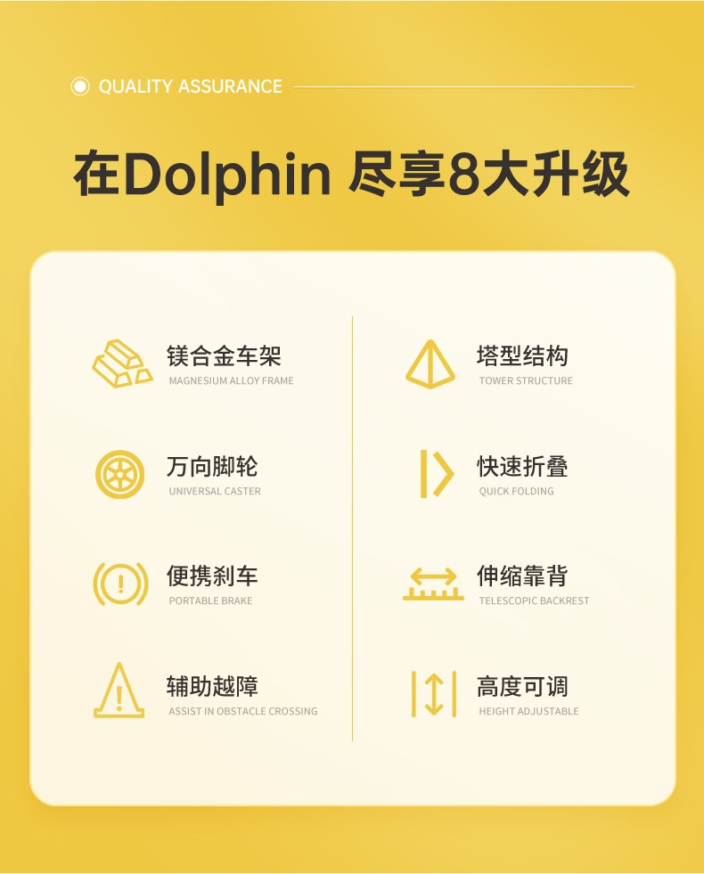
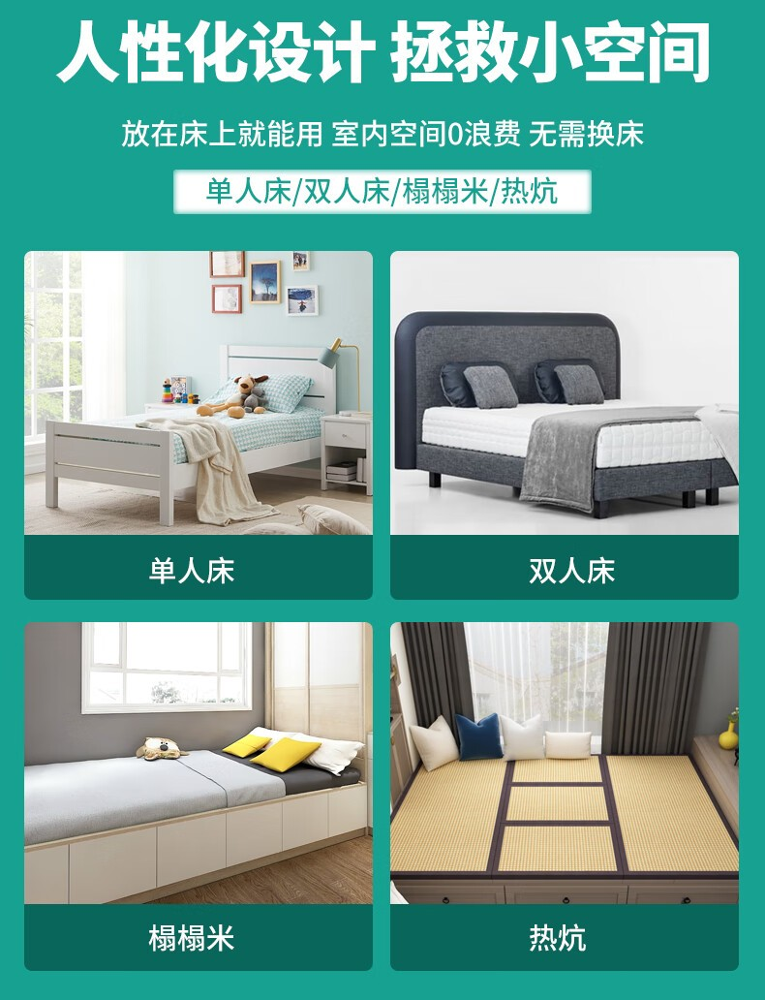
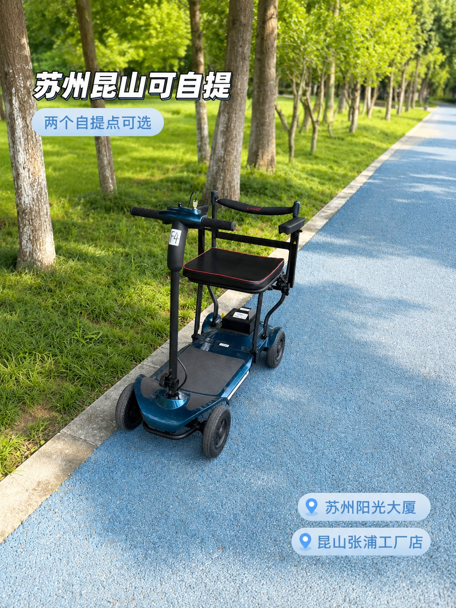

# 5 类康复辅具摆一起实测：轮椅、代步车、助行器、移位机、护理床，各管什么

店里把五类东西摆在一起的时候，最容易发生的一幕是：家属指着一台助行器问"这个能不能当轮椅用"，或者指着一台代步车问"这个能不能推上床"。

不能。这五类产品解决的是五个不同的问题，互相替代不了。我把它们挨个用了一遍，按同一套六项指标打分，结论写在下面。

## 先看结论：五类产品各管什么

| 品类 | 解决什么问题 | 谁在用 | 别拿它当什么 |
|---|---|---|---|
| 电动轮椅 | 长距离出行、自己操控 | 下肢无力但上肢能操作的人 | 别当代步车开上马路 |
| 手动/超轻轮椅 | 短途转移、装车、临时用 | 有人陪护、需要频繁搬动 | 别指望一个人推很远 |
| 老年代步车 | 小区、菜场、接送孩子 | 腿脚还行、反应正常的老人 | 别当医疗器械看，它不上牌不能上路 |
| 助行器 | 康复训练、防跌倒、短距离支撑 | 术后恢复、平衡差的人 | 别当椅子坐 |
| 移位机/护理床 | 卧床转移、翻身、洗护 | 长期卧床、失能老人 | 别指望它替代人手 |

## 评测方法：六项指标，同一套标准

六项：上手难度、稳定性、通过性、收纳、清洁、售后。每项 1 到 5 分，5 分最好。打分依据是实际推、实际折、实际抬，不是看参数表。

### 电动轮椅：上手 4 分，通过性 3 分

电动轮椅的门槛在"学"。操作杆前后左右四个方向，多数人十分钟能走直线，但要练到能过门槛、能倒车入库，得半天。

稳定性是它的强项：自重摆在那，重心低，过减速带不飘。配智能电磁刹车的车型，松手就停，坡道上不溜车，这一项给 5 分。

通过性一般。轮径小的车型过 3 厘米以上的门槛会卡，得抬一下。住老小区、门口有台阶的，先量门槛再选车。

收纳是弱项。整车二三十公斤，一个人搬不上后备箱，得两个人抬。要经常装车的，看折叠款或者超轻款。

### 手动与超轻轮椅：上手 5 分，稳定性 3 分

手动轮椅几乎没有上手成本：刹车一掰、脚踏一放就能用。超轻款更简单，镁铝合金车架，整车十几公斤，一个人能拎上车。

代价是稳定性和通过性。自重轻，路面不平时颠得明显；前轮小，过门槛要翘一下。适合平整路面和短途。

收纳给 5 分。折起来能塞进轿车后排，有的款还能上飞机，电池可拆的电动款也归这一类。

### 老年代步车：上手 4 分，通过性 5 分

代步车的定位很容易被误解。它是"加粗版的电动轮椅"，四轮、大轮径、有避震，过砖路、上路沿都稳，通过性给满分。

但它不是医疗器械，也不能上机动车道。买之前要跟老人说清楚：小区、菜场、公园可以，马路不行。

上手 4 分：把手式操控比操作杆直观，但车身宽，窄楼道掉头费劲。

### 助行器：上手 5 分，稳定性 4 分

助行器是五类里最容易上手、也最容易被低估的。术后第一周、平衡还没恢复的时候，助行器比轮椅有用：它能让人站着走，肌肉不掉得那么快。

稳定性看结构。四脚带轮、带刹车的款最稳；两脚拐杖式的灵活但支撑面小。镁合金车架的款轻，一只手能提，出门带着不费劲。

通过性一般，楼梯基本不行。收纳给 5 分，折起来靠墙放。

### 移位机与护理床：上手 3 分，省力 5 分

这两类不是给使用者自己用的，是给照护者的。

移位机解决"从床到轮椅、从轮椅到马桶"的转移。液压或电动升降，一个人能给卧床的老人换位置，腰不废。上手要学，第一次用最好有人在旁边看着。

护理床解决翻身、抬背、抬腿。多功能款能调背部和腿部角度，配合防褥疮床垫，长期卧床的人能少受很多罪。这类产品占地方，买之前量房间。

## 打分汇总

| 品类 | 上手 | 稳定 | 通过 | 收纳 | 清洁 | 售后 |
|---|---|---|---|---|---|---|
| 电动轮椅 | 4 | 5 | 3 | 2 | 4 | 5 |
| 手动/超轻轮椅 | 5 | 3 | 3 | 5 | 5 | 5 |
| 老年代步车 | 4 | 4 | 5 | 2 | 4 | 4 |
| 助行器 | 5 | 4 | 3 | 5 | 5 | 5 |
| 移位机/护理床 | 3 | 5 | 1 | 1 | 4 | 5 |

售后这一列之所以普遍高分，是因为这家公司的承诺是电控系统保 2 年、车架保 5 年，配件自己厂里出。这是购买才有的；租的话按协议走。

## 三个最容易买错的组合

**用助行器替代轮椅。** 术后早期站不稳，助行器反而危险。顺序应该是：先轮椅，能站了再助行器，最后才是自己走。

**用代步车替代轮椅。** 代步车宽、重、转弯半径大，室内根本转不开。它适合室外，室内还得靠轮椅。

**买了护理床，没买移位机。** 床能抬背，但人还是抬不动。卧床照护真正省力的是移位机，两件配合才完整。

<figure><figcaption>助行器的八项升级点，基本覆盖了选购时要看的全部结构。图：佳康顺</figcaption></figure>

## 一台助行器值不值得买，看这四处

第一看车架。镁合金比铝合金轻三成，同样承重下更省力。

第二看脚轮。万向轮转弯灵活，但要在平整地面用；固定轮稳，适合粗糙路面。

第三看刹车。带刹车的款能在斜坡上停住，没有刹车的只能靠人扶。

第四看高度。扶手高度要卡在手腕位置，太高耸肩，太低弯腰。可调的款更保险。

<figure><figcaption>护理床不是只有医院那种。图里是四种常见摆放形态，买之前先量房间。图：佳康顺</figcaption></figure>

## 场景实测：同一段路，四种车各走一遍

小区里那段 200 米的路，我推了四遍：一段砖路、两个减速带、一个 3 厘米门槛、一段上坡。

- 电动轮椅：砖路上稳，减速带要减速，门槛卡了一次，上坡没问题。
- 手动轮椅：砖路颠，减速带要抬前轮，门槛要翘，上坡需要人推。
- 代步车：全程最轻松，减速带和门槛都过得去，上坡有劲。
- 助行器：只在平路走，门槛能过，上坡吃力。

结论很朴素：路况决定车型，不是预算决定车型。

<figure><figcaption>代步车通过性最好，但只能在小区、公园这类非机动车环境用。图：佳康顺</figcaption></figure>

## 常见问题

### 助行器和轮椅能互相替代吗？

不能。轮椅解决"走不了"，助行器解决"走不稳"。术后早期用轮椅，能站了换助行器，是常规顺序。

### 代步车能上马路吗？

不能。它不属于机动车，也不属于医疗器械，只能在小区、公园、厂区这类封闭或非机动车环境使用。

### 护理床一定要买吗？

长期卧床才需要。短期卧床用防褥疮床垫加普通床就能应付，买之前先确认照护周期。

### 这五类里哪类最适合租？

轮椅和助行器最适合租，使用周期短、需求明确。移位机和护理床也可以租，但要看家里的门宽和电梯。

## 最后

五类产品没有高低之分，只有配对错。买之前先回答一个问题：使用者现在最缺的是"走得远""走得稳"还是"起得来"。答案不同，品类就不同。

- 昆山张浦工厂店：昆山市张浦镇俱进路379号B栋二楼
- 苏州取车点：西环路阳光大厦9楼
- 官网：[unqcare.com](https://www.unqcare.com/)
- 服务热线：400-667-6108
- 轮椅租赁微信：tian42629

## 资料来源

- 佳康顺官网《关于我们》页：<https://www.unqcare.com/p/about.html>（产品两大系列、质保承诺）
- 公司产品资料：五类产品的结构参数与适用场景
- 公司《轮椅租赁协议》与《轮椅租赁流程》：租赁范围、押金与退还
