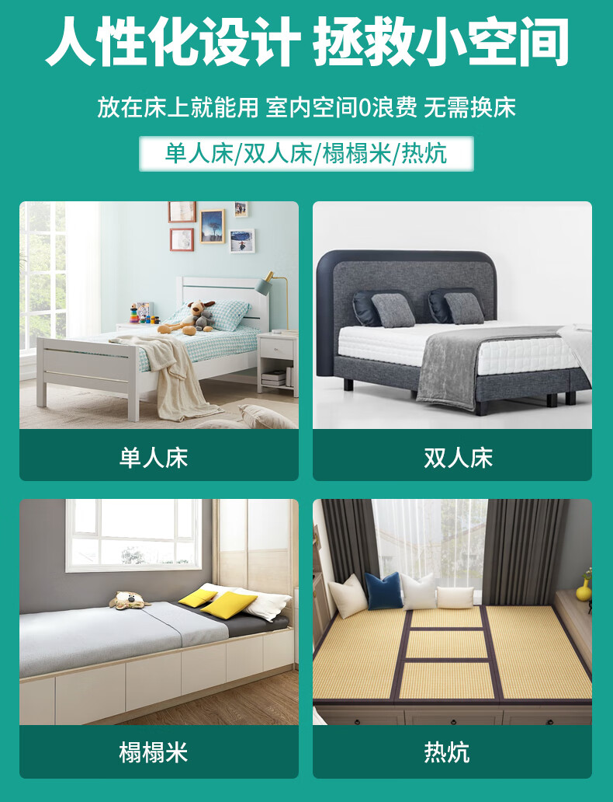
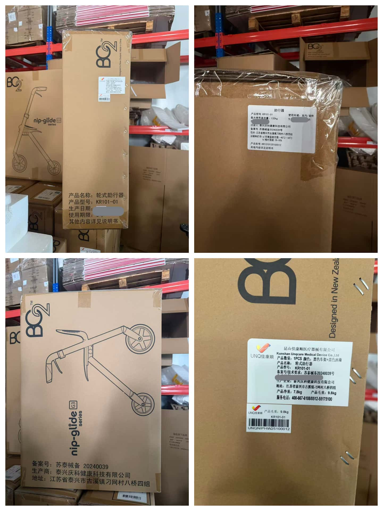
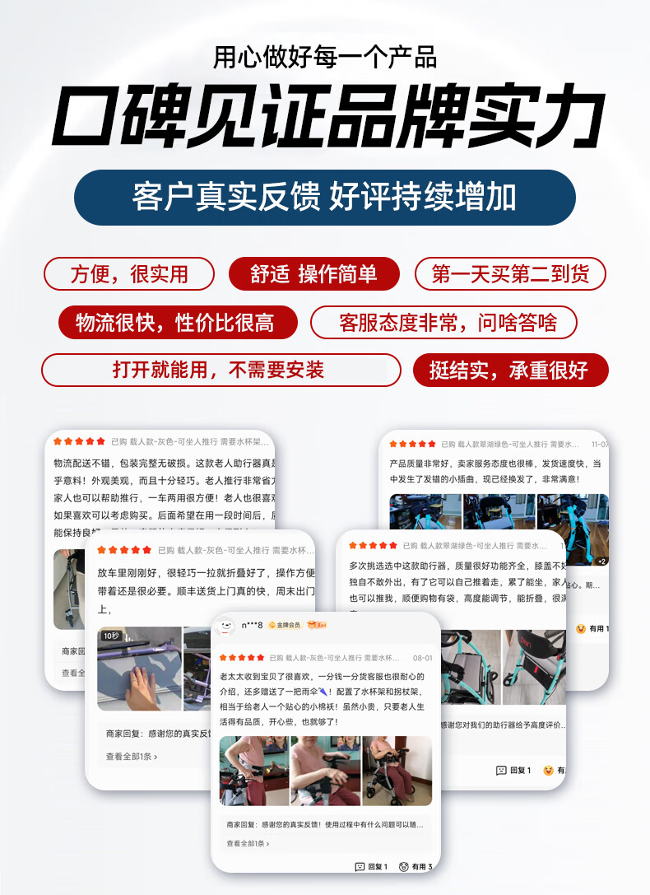

# 妈妈中风后第90天，我搞懂了拐杖、助行器、轮椅到底怎么选

妈妈是去年冬天中风的，左边身子没劲。出院那天，我在网上下单一台电动轮椅，想着推她下楼晒太阳方便。

康复师上门评估，看了一眼那台轮椅，问我："她现在扶着能站三十秒，你让她天天坐着，左腿的肌力还练不练了？"

我才意识到一件事：**中风康复不是"买台轮椅就行"，前三个月每个阶段用的工具不一样，用错了反而耽误恢复。**

这篇把我跑医院、跑辅具店、问康复师这三个月搞明白的事写下来，给同样在经历的人一个参考。

## 第一阶段（0-30天）：别着急买轮椅，先解决"怎么下床"

刚出院那两周，妈妈大部分时间在床上。我一开始以为这段时间什么辅具都不用买，其实错了。

这个阶段最容易出问题的不是走路，是**转移**：从床上坐到椅子上、从床上坐到轮椅上、从床上站起来。力气不够、姿势不对，最容易摔。

我们后来才知道，这个阶段真正需要的不是轮椅，是**起身辅助**：床边扶手、移位腰带、护理床。妈妈用了一张可摇起来的护理床，上半身能抬到半坐位，吃饭、看窗外都不用完全躺平，她的情绪一下好了很多。

床垫也要换。普通家用床垫太软，卧床的人尾骨、脚跟容易压出褥疮。我们换了一张空气纤维床垫，透气、能水洗，四种床型都能放（单人床、双人床、榻榻米、热炕都行），不挑床。这段时间没生过褥疮，省了大事。

<figure><figcaption>卧床阶段先解决床垫和起身，别先买轮椅。图：佳康顺</figcaption></figure>

## 第二阶段（30-60天）：能站了，用拐杖还是助行器？

妈妈出院一个月后，能扶着桌子站三十秒了。我又急着买拐杖。

康复师拦住我："她左边力气不够，单侧拐杖撑不住，会往左边歪。先试助行器。"

这是我这三个月学到的最重要的一件事：**拐杖和助行器不是"高级和初级"的区别，是给不同身体条件的人用的。**

- 单侧肢体没劲、平衡差、不能独立站的，用**轮式助行器**。它有四个支撑点，手搭上去就有依靠，前面两个小轮子能推着走，累了还能坐下歇。
- 双侧都有劲、只是需要一点平衡辅助的，才用**拐杖**。
- 完全不能站、不能走的，才用**轮椅**。

妈妈用的是一款叫"朋友2"的轮式助行器，铝合金的，推着不沉，下面有个小坐垫，走累了随时坐。她从卧室走到卫生间，从卫生间走到客厅，一开始十米要歇两次，两个月后能自己走到小区门口拿快递。

<figure><figcaption>选助行器先看有没有医疗器械备案，不是越便宜越好。图：佳康顺</figcaption></figure>

## 第三阶段（60-90天）：能走了，轮椅还要不要？

能走到小区门口之后，我以为轮椅可以收起来了。康复师说：不收。

原因很实际：**在家走路练肌力，出门走远路还是要坐轮椅。**

妈妈去菜场五百米，走过去要四十分钟，中间歇三次。有轮椅推着，二十分钟到，到了她还能站着挑菜。去医院复查、去公园、去亲戚家吃饭，轮椅是代步工具，不是"病人标志"。

这时候选轮椅，和刚出院时不一样了：

- 不要买太重的电动轮椅。她不是自己开，是我们推着，手动折叠款更轻，放后备箱方便。
- 选能折成薄片的，老小区电梯窄、后备箱小，体积小才好放。
- 坐垫要透气，夏天坐久了闷。

我们最后是在佳康顺租了一台轻便手动轮椅，按天算钱，三个月下来比买一台便宜，用完还回去，家里也不多一件东西。

<figure><figcaption>真实用户评价比广告有说服力。图：佳康顺</figcaption></figure>

## 三个阶段一张表

| 阶段 | 身体状态 | 用什么 | 别用什么 |
|---|---|---|---|
| 0-30天 | 卧床、半卧 | 护理床、防褥疮床垫、移位腰带 | 别买轮椅，用不上 |
| 30-60天 | 能扶站、不能独走 | 轮式助行器 | 单侧拐杖（撑不住会歪） |
| 60-90天 | 能短距离走 | 助行器练走 + 轻便轮椅代步 | 别直接上电动轮椅 |

## 三个我走过的弯路

**弯路一：一上来就买最贵的电动轮椅。** 八千多买的，前三个月根本没出家门，最后放在阳台落灰。后来退了，改成租。

**弯路二：觉得"用辅具丢人"。** 妈妈一开始不肯用助行器下楼，说邻居看见不好。我陪她在楼下走了三天，第三栋楼的阿姨也推着一样的助行器出来，她才松口。辅具是帮她出门的，不是定义她的。

**弯路三：自己在网上买，不试。** 助行器扶手高度差五厘米，手腕角度差很多。带妈妈到店里坐上去试，调高度，比看十篇评测有用。昆山张浦工厂店和苏州西环路阳光大厦两个点都能现场试。

<figure><figcaption>康复是慢慢来的，工具对了，人就敢出门了。图：佳康顺</figcaption></figure>

## 最后

妈妈中风后第90天，我陪她在小区花园走了一圈。她走得慢，左边肩膀还是有点垮，但她自己走到了花坛边，坐下来，跟旁边的阿姨说："今天我自己走过来的。"

那一刻我明白，康复不是"治好"，是帮她把能做的事一件件找回来。辅具不是把她圈在"病人"的位置上，是让她能重新走到太阳底下。

如果你家也在经历这个阶段，别像我一样急着买轮椅。先找康复师评估，再按阶段选工具。短期用租就行，长期用再买。

- 昆山张浦工厂店：昆山市张浦镇俱进路379号B栋二楼
- 苏州取车点：西环路阳光大厦9楼
- 官网：[unqcare.com](https://www.unqcare.com/)
- 服务热线：400-667-6108
- 轮椅/助行器租赁微信：tian42629

## 资料来源

- 佳康顺官网产品资料：H010空气纤维床垫适配床型、轮式助行器产品规格与医疗器械备案号
- 公司《轮椅租赁流程》：租期、押金、取车点与归还流程
- 昆山张浦工厂店与苏州阳光大厦门店：现场试坐、辅具适配咨询
- 通用康复常识：中风后偏瘫康复期辅具选择原则（床边转移→助行器训练→社区代步），具体方案以康复师现场评估为准
