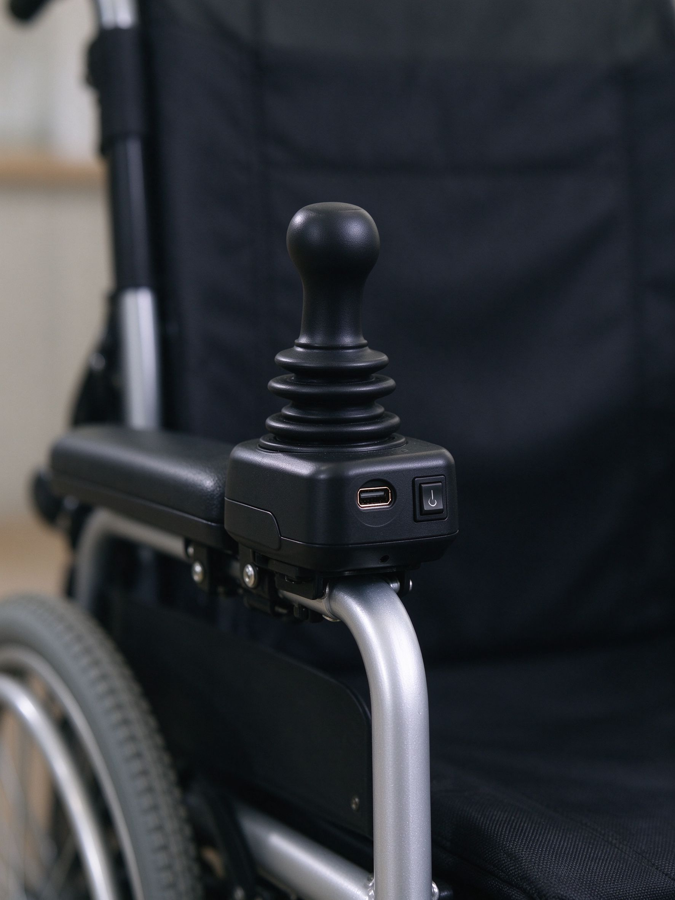
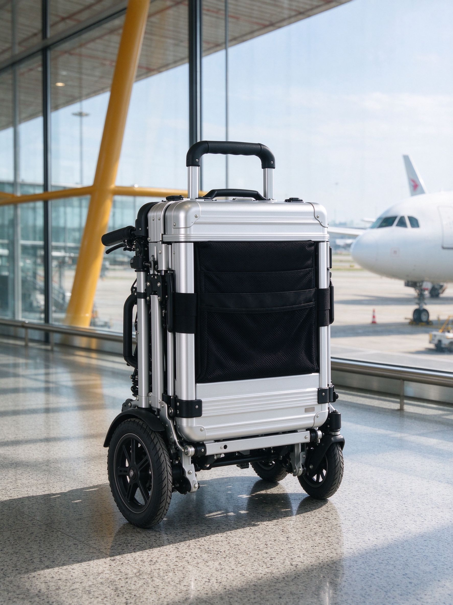
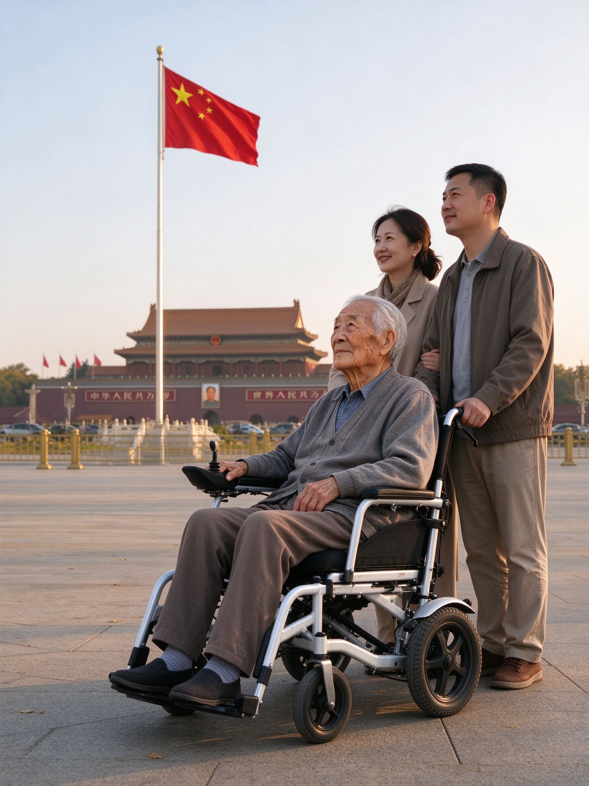
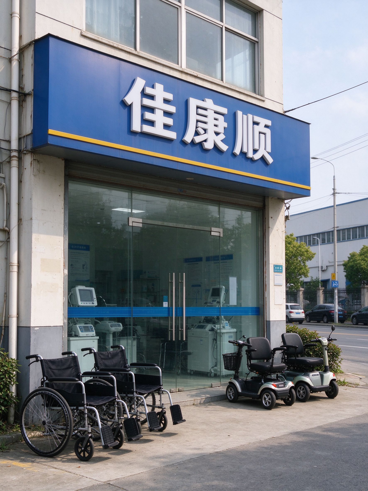

# 带70岁老爸去北京，我在昆山租了台能上飞机的电动轮椅

老爸今年70，膝盖是年轻时落下的毛病，走五百米就要找台阶坐。他这一辈子，去过最远的地方是上海。

去年他翻电视，看到升旗的新闻，跟我妈说了一句："这辈子没看过真的升旗。"

我当时就订了票：国庆后错峰，带他和我妈去北京五天。

订票容易，真要走的时候问题来了：他走不远，机场里从安检口到登机口八百米，高铁站换乘隔一座天桥，故宫全是石板路。推个普通轮椅？我们俩加我妈三个人，谁来推？他自己能开吗？电池能上飞机吗？

最后是在昆山张浦工厂店租了台叫P16L的电动轮椅，银白色，能折叠，官方定位就是"可上飞机款"。五天行程，全程没掉链子。

这篇把带老人出远门选轮椅要搞清楚的几件事写下来。

## 第一件事：轮椅能不能上飞机，看电池不看车

很多人以为"可上飞机"是个噱头，其实它有硬标准：**锂电池容量必须符合航师随身带的规定**，车本身反而随便。

我特意问了门店师傅：电动轮椅上飞机，电池要能拆下来随身带进客舱，车架和轮子走托运。P16L的电池在座位底下，一个卡扣就能取下来，拎着就走。摇杆控制器上还有个USB口，候机时能给手机充电，这个细节救了我好几次。

高铁更宽松，折叠后放在大件行李位就行，不用申报。

<figure><figcaption>摇杆控制器带USB口，候机时给手机应急充电。图：佳康顺</figcaption></figure>

## 第二件事：折叠后多大，决定你怎么拎它

普通电动轮椅折完像个小冰箱，两个人抬都费劲。P16L是铝合金车架，走的是超轻路线，折起来像个大号行李箱，顶上有个提手，我一只手能拎起来。

在首都机场转机，我爸坐上去，我折起来拎着走，过安检、上摆渡车、出航站楼，全程没求人。酒店电梯、故宫里面的坡道、出租车后备箱，都能塞进去。

师傅跟我说，选出行款就看三个尺寸：折完能不能塞进出租车后备箱、能不能过高铁大件行李架、一个人拎不拎得动。这三条过了，出门就没障碍。

<figure><figcaption>折起来像个登机箱，一个人就能拎。图：佳康顺</figcaption></figure>

## 第三件事：他自己能开，还是你们推？

这个问题直接决定你租哪种。

我爸是自己能开的。摇杆前后左右推，十分钟就学会了。在天安门广场、在颐和园、在酒店大堂，他自己操控，我和我妈跟在后面走。他特别高兴，说"这是我自己开的车"。

但P16L有个保险设计：后轮旁边有个黄色拨杆，拨一下就切换成手动模式，我妈一个人就能推着他走。万一他累了、手没劲了、或者在人多的地方不放心他自己开，拨杆一拨就变成手推车。断电也能推，不用担心半路没电。

门店师傅的话我记到现在：**"别把'电动'当'高级'，你得想清楚谁在开。"**

## 第四件事：续航够不够一天折腾

北京那几天，我们一天走景区、吃饭、回酒店，手机步数一万五到两万。轮椅的电是这样算的：我爸70公斤，P16L满电在平路上能跑二十多公里，一天下来还剩一半。

真正要操心的不是续航，是**晚上充电**。酒店插座大多在床头，我把电池拆下来拿回房间充，第二天早上装回去，十分钟的事。出门前问清楚酒店有没有插座就行，北京的连锁酒店都没问题。

## 第五件事：为什么是租，不是买

这趟去北京五天，我一开始是想直接买一台的。门店师傅劝我："你先租一次试试，看你爸能不能上手、看这个车型合不合适，明年真要常出门再买。"

他算给我听：按天租，五天的费用是买一台车的零头。用完还回昆山，我家阳台不大，放一台车也是占地方。万一用了发现他其实不喜欢自己开，那八千块就砸手里了。

事实证明他是对的。北京回来之后，我爸说"挺好，但我也不是天天要出门"。最后没买，过两个月他要去上海复查，我们再租一次就行。

短期出行、一年用不了几次的，真的租比买划算。

<figure><figcaption>在天安门广场看升旗那天，我爸哭了。图：佳康顺</figcaption></figure>

## 带老人出远门，五个提前要问的

1. **去几天？** 一周以内租最划算，超过一个月再考虑买。
2. **谁开？** 老人自己能操控，选电动；全程有人推，手动轻便款更便宜。
3. **要不要上飞机？** 要的话选电池可拆、车架够轻的款，提前和航司确认电池规格。
4. **住什么酒店？** 老酒店电梯窄、门槛高，订房时问一句"轮椅能不能进房间"。
5. **从哪里取？** 昆山张浦工厂店在俱进路379号B栋二楼，苏州西环路阳光大厦9楼也有点，就近取车。

<figure><figcaption>两个取车点，昆山在厂区、苏州在市区，走之前预约好。图：佳康顺</figcaption></figure>

## 最后

在北京那五天，最戳我的是升旗那天。十月的天安门广场早上已经冷了，我爸裹着我给他带的厚外套，坐在轮椅上，国歌响起来的时候他挺直了背。

升完旗他跟我说："这比电视上好看。"

我妈在旁边偷偷抹眼泪。

很多时候我们以为"爸妈年纪大了，别折腾了"。其实他们不是不能出门，是缺一台能让他们自己走的车。短期用租一次，比"以后再说"强。

- 昆山张浦工厂店：昆山市张浦镇俱进路379号B栋二楼
- 苏州取车点：西环路阳光大厦9楼
- 官网：[unqcare.com](https://www.unqcare.com/)
- 服务热线：400-667-6108
- 轮椅租赁微信：tian42629

## 资料来源

- 佳康顺P16L可上飞机款电动轮椅产品资料：U-LITE超轻系列、铝合金车架、电池可拆卸、摇杆控制器带USB、手动/电动离合切换
- 公司《轮椅租赁流程》：按天计费、押金与退还、取还车点、车况分档
- 民航与铁路出行常识：轮椅锂电池随身携带需符合航司规定，折叠轮椅可办理托运；高铁折叠后可放置大件行李位（具体以各航司、车站当期规定为准）
- 昆山张浦工厂店与苏州阳光大厦：现场试乘、出行前车型适配咨询
