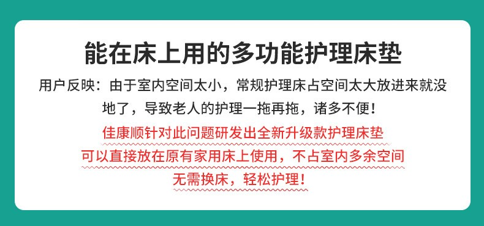
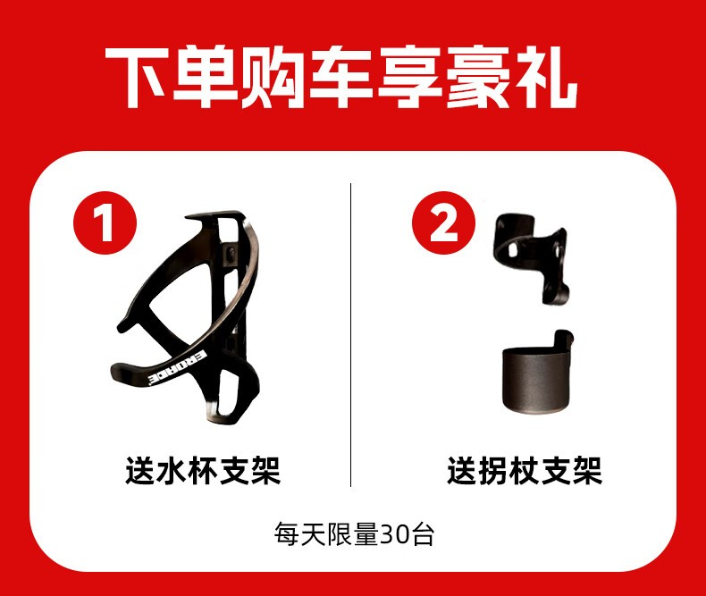
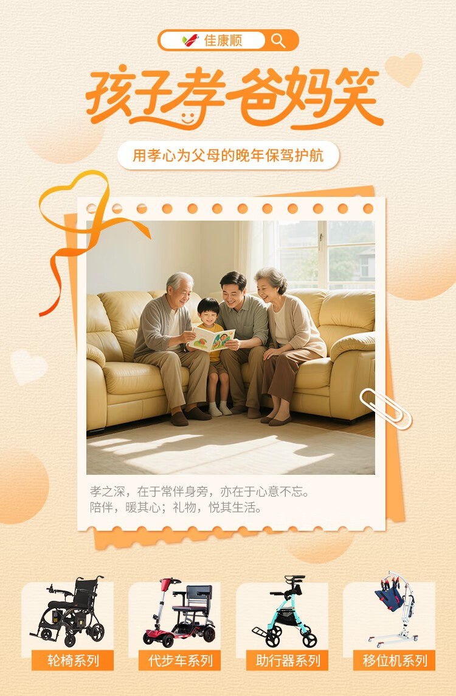

# 推着轮椅过了7天：电梯、门槛、菜市场、地铁、雨天，哪一关最难

参数表上的"爬坡 6 度""越障 4 厘米"，放进真实生活里是什么感觉？我借了一台电动轮椅，在昆山过了七天，每天走一条平时最常走的路。

结论先放这儿：**最难的不是台阶，是电梯。** 台阶能垫斜坡，电梯门窄了没法改。

## 七天走了哪五关

- 第一天、第二天：小区电梯和家门口的门槛
- 第三天：菜市场
- 第四天：地铁和公交
- 第五天：雨天
- 第六天、第七天：医院和药店，顺路把车还了

每天记三件事：过不过得去、卡在哪、怎么解决。

## 第一关：电梯，最难的一关

我家电梯门净宽 80 厘米，轿厢深 1.4 米。电动轮椅整车宽 63 厘米，理论上进得去。

实际进的时候要正对门口、慢慢对中，斜一点就蹭门框。轿厢里掉头更麻烦：1.4 米的深度，轮椅长 1.1 米，掉头要来回三次。

**实测结论**：电梯门低于 80 厘米、轿厢深度小于 1.3 米的老楼，选车要先量尺寸，别先看型号。轮椅宽度一般在 60 到 66 厘米之间，留 10 厘米余量最稳。

还有个容易忽略的点：按钮高度。有些老电梯的按钮装在 1.1 米以上，坐姿伸手够不到，得带一根取物杆。

## 第二关：门槛，3 厘米是个分水岭

家里卫生间门槛 3 厘米，阳台 5 厘米，入户门 2 厘米。

3 厘米以内，电动轮椅能自己过，但会顿一下；5 厘米就过不去了，前轮卡住，得有人抬。

**解决办法**：橡胶斜坡垫。3 厘米的买 10 厘米宽的，5 厘米的买 15 厘米宽的，一卷几十块，剪一段铺上就行。这是七天里最值的一笔投入。

## 第三关：菜市场，地面比台阶更难

菜市场没有台阶，但地面是抛光砖，早上有水。

电动轮椅在湿砖上刹车距离明显变长，转弯会轻微侧滑。**带电磁刹车的车型优势在这里体现**：松手就停，不用靠反应速度。

摊位高度也是个问题。大部分菜摊台面在 70 到 80 厘米，坐姿视线低于台面，挑菜要仰头。这一关没有技术解法，只能靠人陪着。

<figure><figcaption>空间不够是所有辅具的共同难题。这张用户反馈说的是护理床，道理和电梯一样：先量空间，再选产品。图：佳康顺</figcaption></figure>

## 第四关：地铁和公交，差距很大

地铁站有无障碍电梯，从地面到站台一路能推过去。车厢和站台之间的间隙大约 5 厘米，电动轮椅能自己过，手动轮椅要抬前轮。

公交是另一回事。昆山的低地板公交有翻板，但翻板要司机下来操作，高峰期不一定愿意。七天里我只成功上过一次公交。

**实测结论**：短途靠轮椅，中长途优先地铁，公交当备选。要坐飞机、坐高铁的，选能上飞机的超轻折叠款，电池拆下来单独带。

## 第五关：雨天，三个地方会出问题

第一是刹车。湿地面刹车距离变长，下坡要提前松杆。

第二是坐垫。布坐垫淋一次雨，两天不干。防水坐垫是必需品。

第三是电机和控制器。正规产品的电控有防护等级，但接口处进水还是会出故障。下雨天能用雨罩就用雨罩，回家把车擦干再充电。

## 七天下来的一张对照表

| 场景 | 电动轮椅 | 手动轮椅 | 代步车 | 助行器 |
|---|---|---|---|---|
| 电梯（门宽80cm） | 能进，要慢 | 轻松 | 偏宽，勉强 | 轻松 |
| 3厘米门槛 | 能过 | 要翘前轮 | 能过 | 能过 |
| 5厘米门槛 | 过不去 | 要抬 | 能过 | 过不去 |
| 湿滑地面 | 要减速 | 要人扶 | 相对稳 | 不稳 |
| 地铁 | 能 | 能 | 不建议 | 能 |
| 公交 | 看车型 | 要抬 | 不建议 | 能 |
| 菜市场 | 能，视线低 | 能，要人推 | 能 | 短距离可以 |

## 两百块以内的改造清单

七天里真正解决问题的，不是换车，是这几样小东西：

- 橡胶斜坡垫：解决 3 到 5 厘米门槛，几十块
- 防水坐垫：解决雨天和清洁，几十块
- 雨罩：解决整车防雨，几十块
- 取物杆：解决高处按钮和开关，十几块
- 杯架、拐杖架：出门带水、带拐杖，几十块

<figure><figcaption>杯架和拐杖架这类小配件，出门时的用处比想象中大。图：佳康顺</figcaption></figure>

## 七天之后：什么车配什么场景

- 家里有电梯、主要在小区和菜场活动：电动轮椅够用，重点看宽度和刹车。
- 老楼没电梯、需要经常搬上车：超轻手动轮椅或可折叠电动款，重点看重量。
- 要接送孩子、跑公园：老年代步车，通过性最好。
- 术后康复期：先轮椅，能站了换助行器，别一步到位。

## 常见问题

### 电动轮椅能上地铁吗？

能。地铁有无障碍电梯，车厢与站台间隙约 5 厘米，电动轮椅能自己过。进站前走无障碍通道，别走闸机。

### 门槛太高怎么办？

3 厘米以内靠车辆自身越障能力，5 厘米以上要垫斜坡。橡胶斜坡垫是最便宜的解法，按门槛高度选宽度。

### 雨天能出门吗？

能，但要做三件事：坐垫换成防水的、整车套雨罩、回家擦干再充电。湿滑地面刹车距离会变长，下坡提前减速。

### 租的车能带走这些配件吗？

斜坡垫、雨罩这类小件可以自己买，几十块钱。车上原配的杯架、拐杖架按车型配，租的时候问一句。

<figure><figcaption>同一套场景测试下来，不同品类的差别比参数表上更大。图：佳康顺</figcaption></figure>

## 最后

七天里，车没出过故障，卡住的都是环境：窄电梯、高门槛、湿地面、公交车门。这也说明一件事：选辅具不是选参数最高的那台，是选能通过你家那扇门的那台。

出发前量三个数：电梯门净宽、家里最高门槛、车门开口高度。这三个数定了，选车范围就缩小了一大半。

- 昆山张浦工厂店：昆山市张浦镇俱进路379号B栋二楼
- 苏州取车点：西环路阳光大厦9楼
- 官网：[unqcare.com](https://www.unqcare.com/)
- 服务热线：400-667-6108
- 轮椅租赁微信：tian42629

## 资料来源

- 佳康顺官网《关于我们》页：<https://www.unqcare.com/p/about.html>（产品系列、质保承诺）
- 公司产品资料：电动轮椅整车宽度、越障高度、爬坡能力、电池与折叠参数
- 公司《轮椅租赁流程》：取车点、验车、押金与退还、清洁消杀分级
