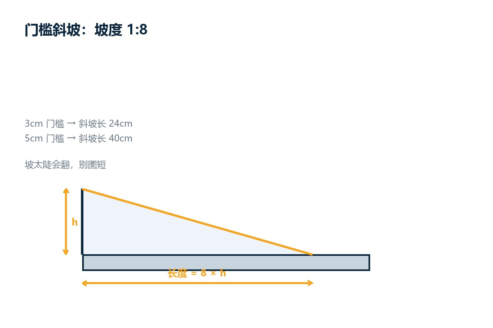
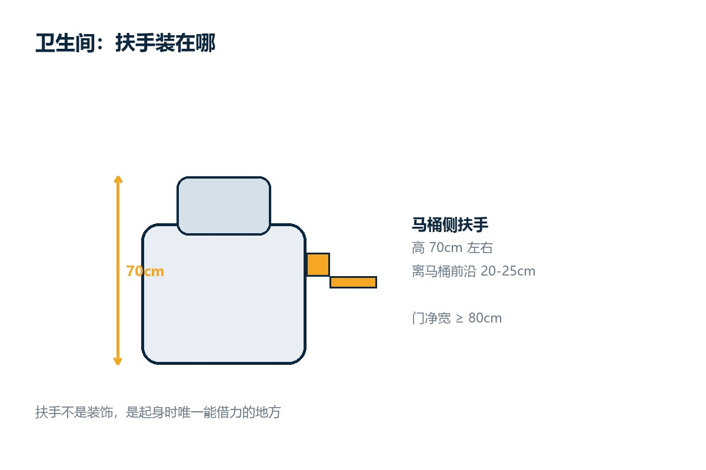
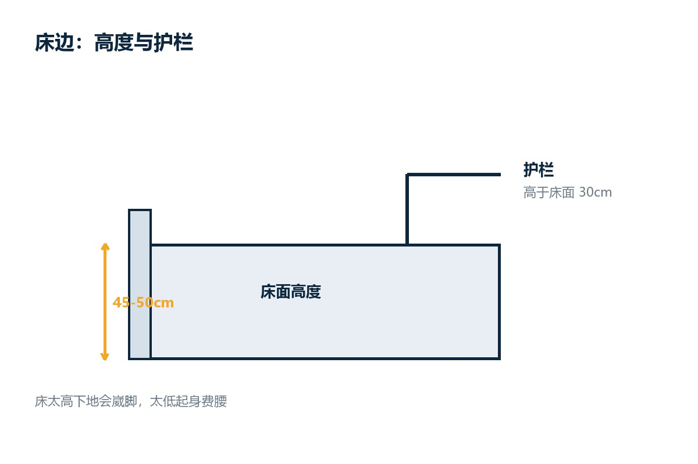

# 家里这三处改一下，老人能少摔一半跤

摔倒这件事，多数人以为是走路不小心。真到家里看一圈会发现，问题出在三个固定的地方：门槛、卫生间、床边。

这三处的共同点是：都要"转移重心"。跨门槛要抬脚，进卫生间要转身，下床要撑起来。重心一动，平衡差的人就容易失手。

改造不一定要大动干戈。下面按"改哪里、改到什么数、先改哪一处"来说。佳康顺在昆山做了十几年康复辅具，上门看过的家庭里，九成的问题都出在这三处。

## 第一处：门槛，三厘米是个分水岭

家里最高的门槛通常在卫生间和阳台。3 厘米以内，多数人能自己过；超过 3 厘米，抬脚高度不够的人就会绊。

**改法一：垫斜坡。** 橡胶或铝合金斜坡垫，坡度按 1:8 做，也就是高度 3 厘米配 24 厘米长的坡面，5 厘米配 40 厘米。

坡度别图陡。1:6 以下的斜坡推轮椅上去费劲，下坡容易冲；1:10 以上又太长，占地方。1:8 是平衡点。

**改法二：压条过渡。** 门槛不高、只是有个台阶沿的，用半圆压条或者斜面压条盖住，成本低，老人抬脚也顺。

家里有轮椅的，还要看车本身：P16L 这类镁铝合金折叠款整车轻，一个人能拎过门槛；车重的电动款就必须配斜坡，抬不动。

**别做的事**：把门槛直接砸掉。卫生间门槛往往兼着挡水的功能，砸了水会往外流，反而添新麻烦。

<figure><figcaption>斜坡长度按高度的 8 倍算，3 厘米门槛配 24 厘米坡面。示意图：佳康顺</figcaption></figure>

## 第二处：卫生间，扶手比防滑垫更重要

卫生间是家里摔倒最集中的地方，因为它同时具备三个条件：地面湿、空间小、要转身。

**扶手。** 马桶侧边装一根，高度 70 厘米左右，离马桶前沿 20 到 25 厘米。淋浴区再装一根竖向的，高度从 60 厘米到 120 厘米，抓着能借力站起。

扶手要装在承重墙上，空心砖墙要先加固。装完用手全身压一下，晃动的必须重装。

**地面。** 防滑垫选带吸盘的，铺在淋浴区和马桶前。整片铺的地垫反而危险，边角容易翘起来绊脚。

**淋浴。** 能坐着洗就别站着洗。一把淋浴椅加一个手持花洒，比任何防滑措施都管用。术后康复期用助行器过渡的，Dolphin 这类镁合金款一只手能提，进出卫生间不占地方。

**门。** 门净宽低于 80 厘米，轮椅和助行器都进不去。推拉门比平开门安全，不会因为往里推撞到人。

<figure><figcaption>扶手高度按坐姿肘部略低一点来定，70 厘米是常见值。示意图：佳康顺</figcaption></figure>

## 第三处：床边，高度和护栏

床是每天上下最多次的地方，也是夜里起身最容易出事的地方。

**床面高度。** 坐在床沿，双脚能平放地面、膝盖大约 90 度，这个高度就对。常见值是 45 到 50 厘米。床太高，下地时脚够不着地会崴；太低，起身要用手撑，腰受力大。

**护栏。** 一侧装护栏，高于床面 30 厘米左右，能防止翻身掉下去，也能当起身的扶手。护栏别装太高，太高反而挡着下床。

**夜灯。** 床脚到卫生间那条路上装感应夜灯，起夜不用摸黑找开关。

**呼叫。** 独居老人配一个床边呼叫器或者能挂在脖子上的紧急按钮，几十块到一两百块，比什么保健品都实在。

长期卧床的，床之外还得配两样：H010 这类便携护理床垫防褥疮，天轨移位机负责把人在床和轮椅之间挪，比两个人硬抬省力，也不伤照护者的腰。

<figure><figcaption>床面高度以"坐着双脚能踏实落地"为准。示意图：佳康顺</figcaption></figure>

## 先改哪一处：优先级表

预算有限就按这个顺序来，从"投入小、见效快"排到"投入大、见效慢"。

| 顺序 | 改什么 | 大致投入 | 解决什么问题 |
|---|---|---|---|
| 1 | 卫生间防滑垫 + 淋浴椅 | 几十到一两百元级 | 湿滑摔倒 |
| 2 | 马桶侧扶手 | 一两百元级 | 起身借力 |
| 3 | 门槛斜坡垫 | 几十到一两百元级 | 绊倒、轮椅过不去 |
| 4 | 床边护栏 + 感应夜灯 | 一两百元级 | 夜间起身、翻身坠落 |
| 5 | 门洞加宽、地面找平 | 千元级以上 | 轮椅通行 |

前四项加起来，通常比一次摔倒后的住院花费少得多。

## 三个常见的错误改造

**铺满整屋的地毯。** 地毯边角翘起是新的绊倒源，尤其是有轮子的助行器，压上去会卷边。

**拆掉所有门槛。** 卫生间门槛拆了会返水，厨房门槛拆了会串味，改斜坡比拆更稳妥。

**只在卫生间装扶手。** 老人摔倒的地方还有床边、沙发边、玄关换鞋处。扶手的原则是：凡是需要"蹲下起来"或者"坐下站起"的地方，旁边都该有一个能抓的东西。

## 最后

适老化改造不是把家改成医院。多数时候，一块斜坡垫、一根扶手、一盏夜灯，就能把最危险的那几步路填平。

真要动，建议先请人上门看一遍，把三处的高差、门宽、转身空间都量出来，再决定改哪一处。佳康顺做轮椅和助行器，也帮人看家里的通行尺寸，量完再定方案，比先买设备更省事。
